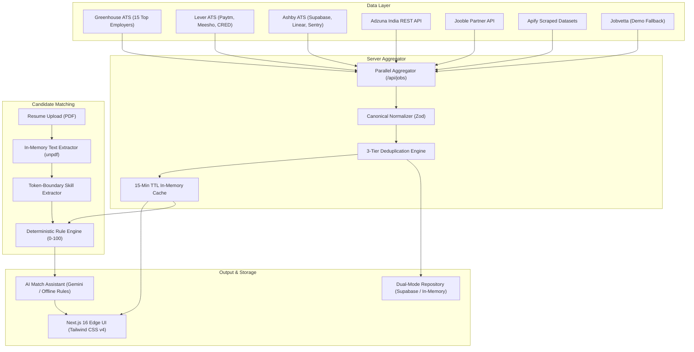

# OneClick Jobs

> **Less Searching. More Getting Hired.**  
> India-focused modern tech job discovery, multi-ATS aggregation, instant privacy-first resume compatibility scoring, and AI-powered career insights.

---

## 📑 Table of Contents

1. [Project Overview](#-project-overview)
2. [Core Architectural Principles](#-core-architectural-principles)
3. [Key Features](#-key-features)
4. [System Architecture & Flow](#-system-architecture--flow)
5. [Providers & Multi-Source Aggregation](#-providers--multi-source-aggregation)
6. [Resume Ingestion & Privacy Model](#-resume-ingestion--privacy-model)
7. [Deterministic Compatibility Scoring Engine](#-deterministic-compatibility-scoring-engine)
8. [AI Career Assistant & Insights](#-ai-career-assistant--insights)
9. [Database & Persistence (Dual-Mode)](#-database--persistence-dual-mode)
10. [Production Engineering & Security](#-production-engineering--security)
11. [Tech Stack](#-tech-stack)
12. [Project Structure](#-project-structure)
13. [Getting Started (Local Development)](#-getting-started-local-development)
14. [Configuration & Environment Variables](#-configuration--environment-variables)
15. [Testing & Quality Assurance](#-testing--quality-assurance)
16. [Deployment Guide (Vercel & Supabase)](#-deployment-guide-vercel--supabase)
17. [API Reference](#-api-reference)
18. [Contributing & Code Conventions](#-contributing--code-conventions)
19. [License](#-license)

---

## 🌟 Project Overview

**OneClick Jobs** was built to solve the frustration of modern tech job seeking in India. Traditional job aggregators are plagued with outdated listings, recruiter spam, duplicate posts across staffing agencies, privacy-invasive candidate databases, and black-box AI ranking algorithms.

OneClick Jobs replaces that model with:
- **Direct Employer Connections**: Aggregates directly from company applicant tracking systems (Greenhouse, Lever, Ashby) with direct application links.
- **Privacy by Design**: Resume PDFs are parsed transiently in server memory (`unpdf`), extracted into a candidate session profile, and **immediately destroyed**. No resume files or PII are ever stored on our servers.
- **Transparent Deterministic Scoring**: A 100% auditable rule-based formula (0–100) scoring Required Skills, Preferred Skills, Experience Alignment, and Work Arrangement with visible explanations.
- **Provider-Agnostic AI Guidance**: Gemini 2.0 Flash generates recruiter-perspective fit summaries, interview talking points, and customized cover letters, backed by instant deterministic fallbacks.
- **Zero-Lockin Resilience**: The entire application runs out of the box with **₹0 cost and zero mandatory API keys**, while seamlessly upgrading to cloud PostgreSQL (Supabase) and third-party APIs (Adzuna, Jooble, Apify, Jobvetta) when keys are provided.

---

## 🏛️ Core Architectural Principles

1. **Failure Isolation**: Upstream external providers are queried in parallel via `Promise.allSettled` with strict 6-second timeouts. If any ATS is slow, rate-limited, or down, the rest of the application functions smoothly.
2. **Canonical Normalization**: Location strings across India (e.g. *"Bangalore"*, *"Bengaluru"*, *"Gurgaon"*, *"Gurugram"*, *"Delhi NCR"*) and tech skills (e.g. *"reactjs"* -> *"React"*, *"k8s"* -> *"Kubernetes"*) are transformed into a single canonical data structure.
3. **Three-Tier Hierarchical Deduplication**:
   - Tier 1: Composite Provider ID match (`provider:externalId`).
   - Tier 2: Canonicalized URL match (stripped UTM and referral query parameters).
   - Tier 3: Entity fingerprint match (`company::normalizedTitle::normalizedCity`).
4. **Offline & Edge Capability**: In-memory caching (`MemoryCache`) and local repositories allow full development and testing without an internet connection or paid services.
5. **Partial Prerendering (PPR) & Cache Components**: Powered by Next.js 16 and Turbopack for sub-second edge response times.

---

## ✨ Key Features

- **Multi-Source Job Search**: Search 400+ verified engineering, product, and data positions across Bengaluru, Mumbai, Pune, Hyderabad, and Delhi NCR.
- **1-Click Location Filters**: Instant filtering by major Indian tech hubs, on-site, hybrid, or remote flexibility.
- **Interactive Match Assistant Drawer**: See exactly why you match or what skills you are missing for every posting.
- **Tailored Cover Letter Starter**: 1-click copyable custom application openers addressed to the specific employer.
- **Browser-Native Bookmarks**: Save listings instantly via `localStorage` with optional cloud backup to Supabase.
- **System Health Monitor**: Live diagnostic telemetry at `/api/health` tracking memory RSS, heap, uptime, and provider connectivity.
- **Dynamic SEO**: Auto-generated `robots.txt` and `sitemap.xml` referencing real job IDs.

---

## 🔄 System Architecture & Flow



---

## 🔌 Providers & Multi-Source Aggregation

OneClick Jobs integrates with seven distinct provider streams:

| Provider | Type | Cost / Keys Required | Covered Employers / Scope |
|---|---|---|---|
| **Greenhouse ATS** | Direct Keyless ATS | **₹0 — No Key Required** | Stripe, MongoDB, Databricks, InMobi, Rubrik, Okta, Elastic, Twilio, Coinbase, Groww, Datadog, Airbnb, Figma, Smartsheet, Workato |
| **Lever ATS** | Direct Keyless ATS | **₹0 — No Key Required** | Paytm, Meesho, CRED (Noida, Bengaluru, Mumbai, Pune, Remote) |
| **Ashby ATS** | Direct Keyless ATS | **₹0 — No Key Required** | Supabase, Linear, Sentry, Resend (India & Worldwide Remote) |
| **Jobvetta API** | Aggregator Feed | Free key (50 req/day) | India tech feed; runs in **Demo Fallback** mode if unconfigured |
| **Adzuna India** | Commercial API | Free tier (250 req/day) | Broad tech jobs across India (`in` country code) |
| **Jooble** | Commercial Partner API | Free partner key | General tech search across Indian hubs |
| **Apify** | Actor Dataset Scraper | Free tier credits | Custom scraped LinkedIn/Indeed/Naukri dataset runs |
| **Demo Fixtures** | Built-in Mock | **₹0 — Offline** | 35 hand-crafted realistic Indian tech positions |

---

## 🔒 Resume Ingestion & Privacy Model

Unlike traditional job boards that store candidate resumes in cloud buckets and sell profile data to recruiters, OneClick Jobs enforces strict **zero-retention in-memory processing**:

1. **Transient Buffering**: The user uploads a PDF (max 5 MB) via `/upload-resume`.
2. **Binary Validation**: Checked for valid `%PDF-` signature.
3. **In-Memory Text Extraction**: Parsed via `unpdf` into raw text without spawning native C++ binaries or external processes.
4. **Immediate Garbage Collection**: The file buffer is dereferenced and purged from server memory.
5. **Session Profile Storage**: Extracted skills and experience are stored exclusively in the candidate's browser `sessionStorage`. The candidate has full control to edit, add, or remove skills at any time.

---

## 🧮 Deterministic Compatibility Scoring Engine

Compatibility scores are computed transparently via algorithm `v1.0.0-rule-based`:

$$\text{Total Score} = S_{\text{required}} + S_{\text{preferred}} + S_{\text{experience}} + S_{\text{arrangement}}$$

### Weight Distribution:
1. **Required Skills (50%)**: Ratio of candidate skills matching mandatory job tags.
2. **Preferred Skills (20%)**: Bonus score for secondary/nice-to-have technologies.
3. **Experience Alignment (20%)**: Compares candidate tenure against `experienceRange.minYears` and `experienceRange.maxYears`.
4. **Work Arrangement (10%)**: Checks preference alignment with `on-site`, `hybrid`, or `remote`.
5. **Proportional Weight Redistribution**: If a posting does not specify preferred skills or experience criteria, the unallocated points are redistributed proportionally across the remaining criteria so candidates are never penalized for omitted employer metadata.

---

## 🤖 AI Career Assistant & Insights

Located inside the job detail view, the Career Assistant offers actionable insights:

- **Executive Fit Summary**: A 2-sentence breakdown of the candidate's technical suitability.
- **Key Strengths**: Highlighted overlap with the company's core stack.
- **Growth Areas & Gap Analysis**: Constructive recommendations for missing frameworks or libraries.
- **Interview Talking Points**: Tailored technical questions to prepare for architectural interviews.
- **1-Click Tailored Cover Letter**: A professional, customized opening pitch addressed to the hiring manager.

> **Fallback Guarantee**: When `GEMINI_API_KEY` is configured, it calls Google Gemini 2.0 Flash with JSON schema enforcement. If omitted or offline, it executes the [`DeterministicFallbackProvider`](file:///c:/Users/KARAN/Desktop/Web%20Development/Anti%20Gravity/Jobs%20Curator/oneclick-jobs/src/server/ai/provider.ts#L12-L86), generating structured advice instantly without throwing any errors.

---

## 🗄️ Database & Persistence (Dual-Mode)

The persistence layer (`src/server/db/`) supports two interchangeable execution engines:

### 1. Supabase Cloud PostgreSQL (Production Mode)
Activated automatically when `SUPABASE_URL` and `SUPABASE_SERVICE_ROLE_KEY` are provided.
- Tables: `jobs`, `job_sources`, `source_sync_runs`, `saved_jobs`.
- GIN index search for skills and full-text vectors.
- Automated sync audit runs accessible at `/api/sync`.

### 2. High-Performance In-Memory Repository (Local / Offline Mode)
Activated when Supabase environment variables are missing.
- Stores listings in memory with instant query, filter, and sync run tracking.
- Pre-seeded with 35 curated demo jobs.
- **Zero setup overhead and ₹0 cost**.

---

## 🛡️ Production Engineering & Security

Configured in [`next.config.ts`](file:///c:/Users/KARAN/Desktop/Web%20Development/Anti%20Gravity/Jobs%20Curator/oneclick-jobs/next.config.ts) and verified via automated tests:

- **HSTS (HTTP Strict Transport Security)**: `max-age=63072000; includeSubDomains; preload`
- **Clickjacking Defense**: `X-Frame-Options: SAMEORIGIN`
- **MIME Sniffing Defense**: `X-Content-Type-Options: nosniff`
- **Referrer Privacy**: `Referrer-Policy: origin-when-cross-origin`
- **Hardware Isolation**: `Permissions-Policy: camera=(), microphone=(), geolocation=()`
- **Resilient Typography**: Standard web-safe fallback font stacks to eliminate Google Fonts build failures in firewalled environments.
- **Dynamic Route Stability**: Utilizes `await connection()` and `export const instant = false;` to satisfy Next.js 16 Partial Prerendering constraints on `/jobs/[id]`.

---

## 💻 Tech Stack

| Category | Technology | Purpose |
|---|---|---|
| **Core Framework** | Next.js 16.4.3 (App Router) | High-performance React server components & PPR |
| **UI Library** | React 19.3.0 | Modern declarative frontend architecture |
| **Styling** | Tailwind CSS v4 | Lightweight utility-first styling with custom theme |
| **Compiler** | Turbopack | Sub-second local builds and HMR |
| **Icons** | Lucide React | Clean, consistent UI iconography |
| **Schema Validation** | Zod 4.x | Strict runtime boundary validation for all external APIs |
| **PDF Extraction** | unpdf 1.9.1 | Lightweight, serverless-safe in-memory PDF parsing |
| **Test Runner** | Vitest 5.0.4 | Ultra-fast unit & integration test runner |
| **Language** | TypeScript 5.x | Strict static typing throughout client and server |

---

## 📂 Project Structure

```text
oneclick-jobs/
├── docs/                               # Architectural logs, decisions & testing matrices
│   ├── DECISIONS.md                    # Technical and product decision log
│   ├── ROADMAP.md                      # Milestone progress tracking (Phases 0-8)
│   ├── SEARCH_ENGINE.md                # Search engine & location normalization rules
│   └── TESTING_PLAN.md                 # Complete verification matrix
├── public/                             # Static brand assets and favicons
├── src/
│   ├── app/                            # Next.js App Router endpoints & routes
│   │   ├── api/                        # Serverless API routes
│   │   │   ├── health/route.ts         # Live diagnostic health check
│   │   │   ├── jobs/route.ts           # Multi-provider aggregated search API
│   │   │   ├── jobs/[id]/route.ts      # Single job lookup across all providers
│   │   │   ├── jobs/[id]/ai-analysis/  # Gemini/Rule-based career match assistant
│   │   │   ├── resume/parse/route.ts   # In-memory PDF parsing endpoint
│   │   │   └── sync/route.ts           # Background sync & audit log endpoint
│   │   ├── jobs/page.tsx               # Main job discovery catalog & filters
│   │   ├── jobs/[id]/page.tsx          # Dynamic job detail view (PPR compliant)
│   │   ├── saved/page.tsx              # Bookmarked jobs tracker
│   │   ├── upload-resume/page.tsx      # Privacy-first resume upload dropzone
│   │   ├── error.tsx                   # Client-side error boundary
│   │   ├── layout.tsx                  # Root layout with metadata & providers
│   │   ├── not-found.tsx               # Branded 404 recovery page
│   │   ├── page.tsx                    # Landing page with JevJobs-style hero
│   │   ├── robots.ts                   # Crawler instruction generator
│   │   └── sitemap.ts                  # Dynamic XML sitemap generator
│   ├── components/                     # Reusable React components
│   │   ├── filters/                    # Search controls & desktop/mobile filter drawers
│   │   ├── jobs/                       # Job cards, detail views, and AI assistant UI
│   │   ├── layout/                     # Navbar and footer navigation
│   │   ├── ui/                         # Base empty states, loaders, and badges
│   │   └── upload/                     # In-memory resume dropzone & skill chip editor
│   ├── features/                       # Modular business logic & client state hooks
│   │   ├── job-search/                 # Search queries, sorting & demo fixtures
│   │   ├── matching/                   # Candidate profile session context
│   │   └── saved-jobs/                 # LocalStorage persistence hook
│   ├── lib/                            # Formatting utilities & classname mergers
│   ├── server/                         # Server-only modules
│   │   ├── ai/                         # Gemini AI & deterministic fallback providers
│   │   ├── db/                         # Supabase & InMemory repository implementations
│   │   ├── jobs/                       # Normalizer, deduplicator, city aliases, skills
│   │   ├── matching/                   # 0-100 deterministic scoring engine
│   │   ├── providers/                  # External ATS & job board clients
│   │   │   ├── adzuna/                 # Adzuna India client
│   │   │   ├── apify/                  # Apify dataset scraper client
│   │   │   ├── ashby/                  # Ashby ATS public client
│   │   │   ├── greenhouse/             # Greenhouse ATS public client
│   │   │   ├── jobvetta/               # Jobvetta API client
│   │   │   ├── jooble/                 # Jooble partner API client
│   │   │   └── lever/                  # Lever ATS public client
│   │   ├── resume/                     # PDF parser & token-boundary skill extractor
│   │   └── cache.ts                    # Generic Time-To-Live in-memory cache
│   └── types/                          # Canonical TypeScript interfaces & schemas
├── supabase/
│   └── migrations/20261027_init.sql    # Supabase PostgreSQL database migration
├── tests/
│   └── unit/                           # 14 Vitest unit & integration test suites
├── .env.example                        # Documented environment variables template
├── .npmrc                              # Vercel legacy-peer-deps build configuration
├── next.config.ts                      # Security headers & Turbopack configurations
├── package.json                        # Project dependencies and npm scripts
├── vercel.json                         # Vercel deployment framework configuration
└── vitest.config.ts                    # Vitest test runner configuration
```

---

## 🚀 Getting Started (Local Development)

### 1. Prerequisites
- **Node.js**: `v20.x` or `v22.x`
- **npm**: `v9.x` or higher

### 2. Clone and Install
```bash
git clone https://github.com/KaranDarade/OneClick-Jobs.git
cd OneClick-Jobs

# Install dependencies using the configured npm flags
npm install --legacy-peer-deps
```

### 3. Launch the Local Development Server
```bash
npm run dev
```
Open [http://localhost:3000](http://localhost:3000) in your browser. All ATS feeds (Greenhouse, Lever, Ashby) and demo fixtures will load immediately without configuring any environment variables!

---

## ⚙️ Configuration & Environment Variables

Copy `.env.example` to `.env.local` to override configurations locally:
```bash
cp .env.example .env.local
```

| Variable | Required? | Default / Purpose | Where to Obtain |
|---|---|---|---|
| `NEXT_PUBLIC_APP_URL` | Recommended | `https://oneclickjobs.in` (Base URL for SEO and canonical links) | Your domain / Vercel URL |
| `GEMINI_API_KEY` | Optional | Powers AI fit summaries & customized cover letters. Falls back to rule-based engine if empty. | [Google AI Studio](https://aistudio.google.com/app/apikey) |
| `SUPABASE_URL` | Optional | Supabase PostgreSQL REST URL for cloud persistence. | [Supabase Dashboard](https://supabase.com/dashboard) |
| `SUPABASE_SERVICE_ROLE_KEY` | Optional | Supabase secret key for server-side upserts and sync audits. | [Supabase API Settings](https://supabase.com) |
| `NEXT_PUBLIC_SUPABASE_ANON_KEY` | Optional | Supabase public anonymous key for client authentication. | [Supabase API Settings](https://supabase.com) |
| `JOBVETTA_API_KEY` | Optional | Unlocks 50 req/day for Jobvetta India feed. Falls back to Demo mode if empty. | [Jobvetta Dashboard](https://jobvetta.com/dashboard) |
| `ADZUNA_APP_ID` & `ADZUNA_APP_KEY` | Optional | Unlocks 250 req/day for Adzuna India job search. | [Adzuna Developers](https://developer.adzuna.com) |
| `JOOBLE_API_KEY` | Optional | Unlocks Jooble partner search network. | [Jooble Partner Network](https://jooble.org/api/about/api-jobs.html) |
| `APIFY_API_TOKEN` | Optional | Ingests custom scraped LinkedIn/Indeed job datasets from Apify. | [Apify Console](https://apify.com) |

---

## 🧪 Testing & Quality Assurance

OneClick Jobs maintains high test coverage across 14 dedicated test suites:

```bash
# Run all 95 unit & integration tests
npm test

# Run tests in watch mode
npx vitest

# Run TypeScript static typecheck
npx tsc --noEmit

# Test production build locally
npm run build
```

### Summary of Automated Test Suites:
- `locations.test.ts`: Validates 100+ Indian city aliases, NCR regional groupings, and spellings.
- `skills.test.ts` & `resume-skills.test.ts`: Word-boundary regex checks preventing false positives (`Java` != `JavaScript`, `React` != `React Native`, `SQL` != `PostgreSQL`).
- `deduplicate.test.ts`: Validates 3-tier hierarchical deduplication and URL canonicalization.
- `greenhouse.test.ts`, `lever.test.ts`, `ashby.test.ts`: Tests direct ATS schema normalization and India filtering.
- `resume-parser.test.ts`: Tests binary signature checks, corrupt PDF handling, and memory purging.
- `matching-scoring.test.ts`: Validates 0–100 scoring arithmetic and proportional weight redistribution.
- `multi-provider.test.ts`: Validates schema parsing and fallback resilience across Lever, Ashby, Adzuna, Jooble, and Apify.
- `production-readiness.test.ts`: Validates `/api/health`, `robots.txt`, and dynamic `sitemap.xml`.

---

## ☁️ Deployment Guide (Vercel & Supabase)

### Deploying to Vercel
1. Push your repository to GitHub (`main` branch).
2. Go to **[vercel.com/new](https://vercel.com/new)** and import `KaranDarade/OneClick-Jobs`.
3. Vercel automatically detects Next.js through [`vercel.json`](file:///c:/Users/KARAN/Desktop/Web%20Development/Anti%20Gravity/Jobs%20Curator/oneclick-jobs/vercel.json).
4. *(Optional)* Add any environment variables in **Project Settings > Environment Variables**.
5. Click **Deploy**.

### Setting Up Supabase Database (Optional)
1. Create a free project at [supabase.com](https://supabase.com).
2. Open the **SQL Editor** in your Supabase dashboard.
3. Paste and run the contents of [`supabase/migrations/20261027_init.sql`](file:///c:/Users/KARAN/Desktop/Web%20Development/Anti%20Gravity/Jobs%20Curator/oneclick-jobs/supabase/migrations/20261027_init.sql).
4. Copy `SUPABASE_URL` and `SUPABASE_SERVICE_ROLE_KEY` into your Vercel Environment Variables.
5. Trigger your first sync by visiting `/api/sync` or clicking sync in your dashboard.

---

## 📡 API Reference

### 1. `GET /api/jobs`
Query aggregated jobs from all active ATS and provider feeds.
- **Parameters**:
  - `q`: Search keyword or tech stack (e.g. `React`, `Python`, `Frontend`)
  - `location`: City filter (e.g. `Bengaluru`, `Mumbai`, `Delhi NCR`, `Remote`)
  - `arrangement`: Filter array (`on-site`, `hybrid`, `remote`)
  - `experience`: Filter array (`fresher`, `junior`, `mid`, `senior`, `lead`)
  - `sort`: `relevance` | `newest` | `salary-high`

### 2. `GET /api/jobs/[id]`
Lookup single job details across any provider using composite ID prefixes (`greenhouse:*`, `lever:*`, `ashby:*`, `adzuna:*`, `jooble:*`, `apify:*`, `jobvetta:*`, `demo:*`).

### 3. `POST /api/jobs/[id]/ai-analysis`
Generate recruiter-perspective fit analysis, strength/gap lists, talking points, and tailored cover letter starter.
- **Payload**:
  ```json
  {
    "candidate": {
      "skills": ["React", "TypeScript", "Node.js"],
      "experienceYears": 4,
      "preferredArrangement": "remote"
    }
  }
  ```

### 4. `POST /api/resume/parse`
Upload a multipart/form-data PDF resume. Returns extracted technical skills and estimated experience years without persisting the file to disk.

### 5. `GET /api/health`
System diagnostic reporting uptime, memory RSS/heap usage, environment, and live provider connection statuses.

### 6. `GET /api/sync` & `POST /api/sync`
Inspect recent sync history runs or trigger an on-demand aggregation sync into Supabase PostgreSQL.

---

## 🤝 Contributing & Code Conventions

- **Formatting**: Preserve existing ESLint rules and clean TypeScript strict conventions.
- **Commits**: Follow conventional commits (`feat:`, `fix:`, `docs:`, `chore:`).
- **Safety**: Never log or expose candidate resumes, PII, API tokens, or secrets.
- **Branching**: Develop features on isolated topic branches (`feature/...`) and open PRs against `main`.

---

## 📄 License

Distributed under the **MIT License**. Built with ❤️ for tech candidates and engineering teams across India.
