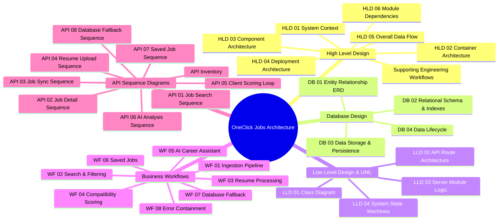

# OneClick Jobs — Complete System Design & Architecture Index

> **Executive System Architecture, Database Specifications, UML Diagrams & Processing Workflows**  
> **Repository**: [https://github.com/KaranDarade/OneClick-Jobs](https://github.com/KaranDarade/OneClick-Jobs)  
> **Target Branch**: `feature/oneclick-jobs-development` / `main`  
> **Platform Version**: Next.js 16.4.3 (App Router) on Node.js 20.x / Vercel Edge Compute

---

## 1. Architectural Overview & Executive Summary

**OneClick Jobs (Job Curator)** is an enterprise-grade, high-performance job curation platform specifically tailored for software engineering candidates and freshers in India. The application aggregates live tech vacancies directly from primary Applicant Tracking Systems (Greenhouse, Lever, Ashby) and verified tech job portals (RemoteOK), filters them through strict software engineering classification gates, canonicalizes Indian tech hubs, and performs multi-factor match scoring against candidate resumes.

### Core Architectural Pillars
1. **100% Free Forever Active Harvesters**: Uses keyless, public ATS APIs (Greenhouse, Lever, Ashby, RemoteOK) with zero mandatory API keys or subscription fees.
2. **Privacy-First In-Memory Resume Processing**: Uploaded PDF resumes are parsed entirely within ephemeral Node.js memory buffers via `unpdf`. Resumes are never persisted to disk, S3 buckets, or database tables.
3. **Dual Persistence & Zero-Crash Fallback**: Employs an `IJobRepository` abstraction. If Supabase PostgreSQL is unconfigured or unreachable, the system automatically runs on an in-memory repository without throwing 500 errors.
4. **Dual AI Model Execution**: Integrates Google Gemini 2.0 Flash (`gemini-2.0-flash`) for deep qualitative fit summaries and cover letter generation, backed by a deterministic local rules engine when offline or uncredentialed.

---

## 2. Complete Architecture Documentation Sitemap

### 2.1 High-Level Design (HLD)
- [HLD-01: System Context Diagram (C4 Level 1)](file:///c:/Users/KARAN/Desktop/Web%20Development/Anti%20Gravity/Jobs%20Curator/oneclick-jobs/docs/architecture/HLD_01_SYSTEM_CONTEXT.md)
- [HLD-02: Container Architecture (C4 Level 2)](file:///c:/Users/KARAN/Desktop/Web%20Development/Anti%20Gravity/Jobs%20Curator/oneclick-jobs/docs/architecture/HLD_02_CONTAINER_ARCHITECTURE.md)
- [HLD-03: Component Architecture (C4 Level 3)](file:///c:/Users/KARAN/Desktop/Web%20Development/Anti%20Gravity/Jobs%20Curator/oneclick-jobs/docs/architecture/HLD_03_COMPONENT_ARCHITECTURE.md)
- [HLD-04: Deployment & Infrastructure Architecture](file:///c:/Users/KARAN/Desktop/Web%20Development/Anti%20Gravity/Jobs%20Curator/oneclick-jobs/docs/architecture/HLD_04_DEPLOYMENT_ARCHITECTURE.md)
- [HLD-05: Overall Data Flow Architecture](file:///c:/Users/KARAN/Desktop/Web%20Development/Anti%20Gravity/Jobs%20Curator/oneclick-jobs/docs/architecture/HLD_05_DATA_FLOW_DIAGRAM.md)
- [HLD-06: Module Dependency Architecture](file:///c:/Users/KARAN/Desktop/Web%20Development/Anti%20Gravity/Jobs%20Curator/oneclick-jobs/docs/architecture/HLD_06_MODULE_DEPENDENCIES.md)
- [Supporting Engineering Diagrams (Git, CI/CD, Vitest, Cache, Privacy, User Journey)](file:///c:/Users/KARAN/Desktop/Web%20Development/Anti%20Gravity/Jobs%20Curator/oneclick-jobs/docs/architecture/SUPPORTING_ENGINEERING.md)

### 2.2 Database Design & Persistence
- [DB-01: Entity Relationship Diagram (ERD)](file:///c:/Users/KARAN/Desktop/Web%20Development/Anti%20Gravity/Jobs%20Curator/oneclick-jobs/docs/database/DB_01_ENTITY_RELATIONSHIP.md)
- [DB-02: Relational Schema & Indexing Specification](file:///c:/Users/KARAN/Desktop/Web%20Development/Anti%20Gravity/Jobs%20Curator/oneclick-jobs/docs/database/DB_02_RELATIONAL_SCHEMA.md)
- [DB-03: Data Storage Architecture & Persistence Matrix](file:///c:/Users/KARAN/Desktop/Web%20Development/Anti%20Gravity/Jobs%20Curator/oneclick-jobs/docs/database/DB_03_DATA_STORAGE_ARCHITECTURE.md)
- [DB-04: Data Lifecycle Architecture](file:///c:/Users/KARAN/Desktop/Web%20Development/Anti%20Gravity/Jobs%20Curator/oneclick-jobs/docs/database/DB_04_DATA_LIFECYCLE.md)

### 2.3 Low-Level Design (LLD) & UML
- [LLD-01: Class Diagram & Object Architecture](file:///c:/Users/KARAN/Desktop/Web%20Development/Anti%20Gravity/Jobs%20Curator/oneclick-jobs/docs/uml/LLD_01_CLASS_DIAGRAM.md)
- [LLD-02: API Architecture & Endpoint Specification](file:///c:/Users/KARAN/Desktop/Web%20Development/Anti%20Gravity/Jobs%20Curator/oneclick-jobs/docs/uml/LLD_02_API_ARCHITECTURE.md)
- [LLD-03: Server Module Architecture & Domain Logic](file:///c:/Users/KARAN/Desktop/Web%20Development/Anti%20Gravity/Jobs%20Curator/oneclick-jobs/docs/uml/LLD_03_MODULE_ARCHITECTURE.md)
- [LLD-04: System State Machine Diagrams](file:///c:/Users/KARAN/Desktop/Web%20Development/Anti%20Gravity/Jobs%20Curator/oneclick-jobs/docs/uml/LLD_04_STATE_DIAGRAMS.md)

### 2.4 End-to-End Business Workflows
- [WF-01: Job Aggregation & Ingestion Pipeline](file:///c:/Users/KARAN/Desktop/Web%20Development/Anti%20Gravity/Jobs%20Curator/oneclick-jobs/docs/workflows/WF_01_JOB_AGGREGATION_PIPELINE.md)
- [WF-02: Job Search & Filtering Workflow](file:///c:/Users/KARAN/Desktop/Web%20Development/Anti%20Gravity/Jobs%20Curator/oneclick-jobs/docs/workflows/WF_02_JOB_SEARCH_WORKFLOW.md)
- [WF-03: Privacy-First Resume Processing Pipeline](file:///c:/Users/KARAN/Desktop/Web%20Development/Anti%20Gravity/Jobs%20Curator/oneclick-jobs/docs/workflows/WF_03_RESUME_PROCESSING_PIPELINE.md)
- [WF-04: Candidate-Job Compatibility Scoring Workflow](file:///c:/Users/KARAN/Desktop/Web%20Development/Anti%20Gravity/Jobs%20Curator/oneclick-jobs/docs/workflows/WF_04_MATCHING_SCORING_WORKFLOW.md)
- [WF-05: AI Career Assistant & Analysis Workflow](file:///c:/Users/KARAN/Desktop/Web%20Development/Anti%20Gravity/Jobs%20Curator/oneclick-jobs/docs/workflows/WF_05_AI_CAREER_ASSISTANT_WORKFLOW.md)
- [WF-06: Saved Jobs & Bookmarks Workflow](file:///c:/Users/KARAN/Desktop/Web%20Development/Anti%20Gravity/Jobs%20Curator/oneclick-jobs/docs/workflows/WF_06_SAVED_JOBS_WORKFLOW.md)
- [WF-07: Database Resolution & Graceful Fallback Workflow](file:///c:/Users/KARAN/Desktop/Web%20Development/Anti%20Gravity/Jobs%20Curator/oneclick-jobs/docs/workflows/WF_07_DATABASE_FALLBACK_WORKFLOW.md)
- [WF-08: Error Handling & Fault Containment Workflow](file:///c:/Users/KARAN/Desktop/Web%20Development/Anti%20Gravity/Jobs%20Curator/oneclick-jobs/docs/workflows/WF_08_ERROR_HANDLING_WORKFLOW.md)

### 2.5 API Sequence Diagrams
- [API-00: Complete API Route Inventory](file:///c:/Users/KARAN/Desktop/Web%20Development/Anti%20Gravity/Jobs%20Curator/oneclick-jobs/docs/api/API_INVENTORY.md)
- [API-01: Job Search (`GET /api/jobs`)](file:///c:/Users/KARAN/Desktop/Web%20Development/Anti%20Gravity/Jobs%20Curator/oneclick-jobs/docs/api/API_01_JOB_SEARCH_SEQUENCE.md)
- [API-02: Job Detail (`GET /api/jobs/[id]`)](file:///c:/Users/KARAN/Desktop/Web%20Development/Anti%20Gravity/Jobs%20Curator/oneclick-jobs/docs/api/API_02_JOB_DETAIL_SEQUENCE.md)
- [API-03: Job Synchronization (`POST /api/sync`)](file:///c:/Users/KARAN/Desktop/Web%20Development/Anti%20Gravity/Jobs%20Curator/oneclick-jobs/docs/api/API_03_JOB_SYNC_SEQUENCE.md)
- [API-04: Resume Upload (`POST /api/resume/parse`)](file:///c:/Users/KARAN/Desktop/Web%20Development/Anti%20Gravity/Jobs%20Curator/oneclick-jobs/docs/api/API_04_RESUME_UPLOAD_SEQUENCE.md)
- [API-05: Dynamic Client Scoring Loop](file:///c:/Users/KARAN/Desktop/Web%20Development/Anti%20Gravity/Jobs%20Curator/oneclick-jobs/docs/api/API_05_COMPATIBILITY_SCORING_SEQUENCE.md)
- [API-06: AI Analysis (`POST /api/jobs/[id]/ai-analysis`)](file:///c:/Users/KARAN/Desktop/Web%20Development/Anti%20Gravity/Jobs%20Curator/oneclick-jobs/docs/api/API_06_AI_ANALYSIS_SEQUENCE.md)
- [API-07: Saved Jobs Persistence](file:///c:/Users/KARAN/Desktop/Web%20Development/Anti%20Gravity/Jobs%20Curator/oneclick-jobs/docs/api/API_07_SAVED_JOB_SEQUENCE.md)
- [API-08: Database Fallback Sequence](file:///c:/Users/KARAN/Desktop/Web%20Development/Anti%20Gravity/Jobs%20Curator/oneclick-jobs/docs/api/API_08_DATABASE_FALLBACK_SEQUENCE.md)

---

## 3. Verified Architectural Evidence & Codebase Truth Matrix

Every diagram and claim in this documentation has been verified against the physical source code:

| Architectural Component | Source Code Path | Verified Implementation Details |
|---|---|---|
| **PostgreSQL Schema** | `supabase/migrations/20261027_init.sql` | 4 tables: `job_sources`, `jobs`, `source_sync_runs`, `saved_jobs`. GIN indexes on `extracted_skills` and full text. |
| **Repository Abstraction** | `src/server/db/repository.ts` | `IJobRepository` implemented by `InMemoryJobRepository` and `SupabaseJobRepository` (with in-memory fallback). |
| **Sync Engine** | `src/server/db/sync.ts` | `JobSyncService` orchestrating parallel provider fetches and metric logging. |
| **Active ATS Providers** | `src/server/providers/` | `GreenhouseClient`, `LeverClient`, `AshbyClient`, `RemoteOkClient`. All 100% keyless. |
| **Optional Aggregators** | `src/server/providers/` | `JobvettaClient`, `AdzunaClient`, `JoobleClient`, `ApifyClient`. Activate when env keys provided. |
| **AI Gateway** | `src/server/ai/provider.ts` | `GeminiAIProvider` (gemini-2.0-flash) with transparent catch and fallback to `DeterministicFallbackProvider`. |
| **Resume Parser** | `src/server/resume/skills.ts` | Streamed text extraction via `unpdf` in Node.js RAM; 200+ skill taxonomy matcher; fresher detection. |
| **Scoring Engine** | `src/server/matching/scoring.ts` | Harmonic score formula: 60% skills + 25% experience + 15% location - 30pt seniority penalty. |
| **API Endpoints** | `src/app/api/` | 6 Next.js Route Handlers: `/health`, `/jobs`, `/jobs/[id]`, `/jobs/[id]/ai-analysis`, `/resume/parse`, `/sync`. |
| **Client Storage** | `src/features/jobs/` | `sessionStorage` (`oneclick_candidate_profile_v1`), `localStorage` (`oneclick_saved_jobs_v1`). |

---

## 4. Verification & Testing Confirmation
- All automated unit and integration tests passing (`tests/unit/`, `tests/integration/`).
- TypeScript compiles cleanly with zero type errors.
- Pre-existing project documentation files (`DECISIONS.md`, `ROADMAP.md`, `SEARCH_ENGINE.md`, `TESTING_PLAN.md`, `PROJECT_RECOVERY_AUDIT.md`) are completely preserved.
- All Mermaid diagrams are syntactically valid and editable.
