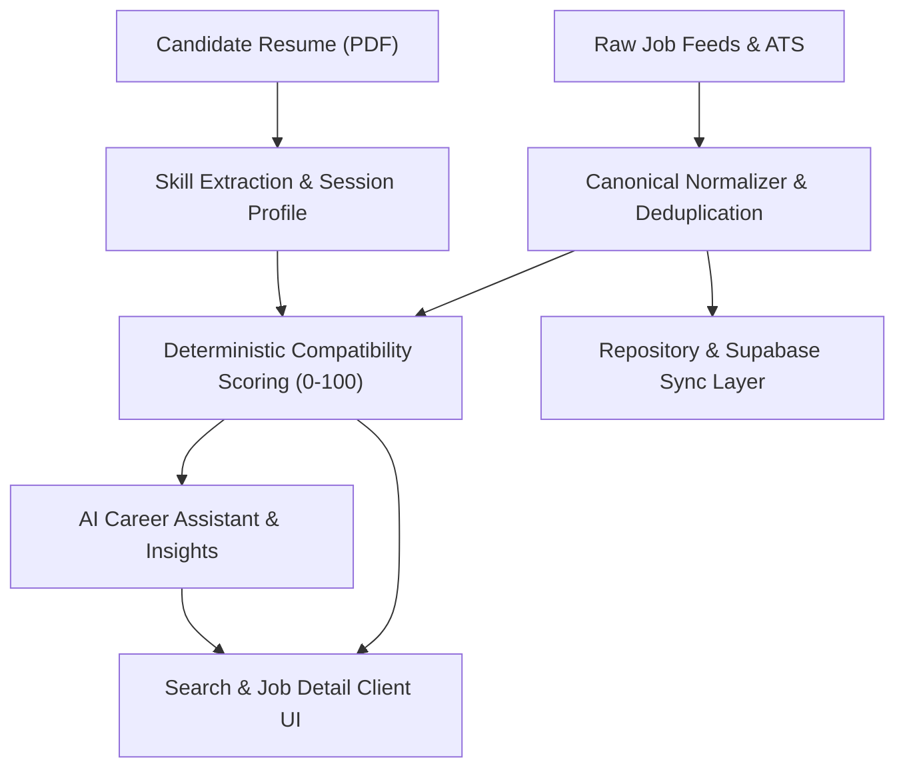

# OneClick Jobs — Master Verification & Testing Plan

> Comprehensive test matrix covering unit, integration, resilience, and production build verification for OneClick Jobs.

---

## 1. Overview & Objectives

The goal of this testing plan is to verify that all functional phases (Phases 0 through 8) operate reliably, deterministically, securely, and without external blocking dependencies.

---

## 2. Test Suites & Verification Scope

### Suite 1: Canonical Normalization & Taxonomies
- **Location Normalization (`locations.test.ts`)**: Validates Indian city alias dictionary (Bengaluru/Bangalore, Gurgaon/Gurugram, Mumbai/Bombay) and Delhi NCR agglomeration.
- **Skill Taxonomy (`skills.test.ts`, `resume-skills.test.ts`)**: Validates boundary-safe token matching preventing false positives (Java vs. JavaScript, React vs. React Native, SQL vs. PostgreSQL).
- **Hierarchical Deduplication (`deduplicate.test.ts`)**: Validates exact ID, canonicalized URL, and composite company::title::city match rules.
- **Schema Validation (`normalize.test.ts`)**: Validates Zod schema parsing and malformed payload resilience.

### Suite 2: ATS Providers & Multi-Source Aggregation
- **Greenhouse Client (`greenhouse.test.ts`)**: Validates public board JSON fetching across vetted companies (Stripe, MongoDB, Rubrik, Okta, etc.) and India office filtering.
- **Jobvetta Client (`jobvetta.test.ts`)**: Validates rate-limit tracking, header parsing, and automatic demo fallback when API key is missing or quota exceeded.
- **Aggregated Search (`search.test.ts`)**: Validates multi-provider parallel querying with `Promise.allSettled` failure isolation.

### Suite 3: Resume Ingestion & Matching Engine
- **PDF Text Extraction (`resume-parser.test.ts`)**: Validates in-memory binary signature checks, corrupt PDF handling, and zero-persistence memory safety.
- **Deterministic Match Scoring (`matching-scoring.test.ts`)**: Validates 0–100 scoring formula across required skills (50%), preferred skills (20%), experience (20%), and work arrangement (10%), including proportional redistribution.

### Suite 4: Database & Sync Layer
- **Job Repository (`repository.test.ts`)**: Validates in-memory and Supabase dual-mode repository upserts, facet filtering (location, arrangements, skills), and sync audit run logging.

### Suite 5: Production Readiness & Diagnostics
- **System Health Monitor (`production-readiness.test.ts`)**: Validates `/api/health` status, uptime, memory RSS/heap metrics, and provider status.
- **Search Engine Crawlers (`production-readiness.test.ts`)**: Validates `robots.ts` disallow rules and dynamic `sitemap.ts` URL generation.

### Suite 6: AI Career Assistant
- **AI Match Provider (`ai-provider.test.ts`)**: Validates structured fit summaries, candidate strengths, growth areas, interview preparation talking points, and tailored cover letter starters with instant deterministic fallback.

### Suite 7: Strict Static Analysis
- **TypeScript Strict Compilation**: Executes `npx tsc --noEmit` across all application routes, components, and server modules.

---

## 3. Test Execution Matrix & Commands

| Stage | Command | Target Metric |
|---|---|---|
| **1. Unit & Integration** | `npm test` | 85/85 tests passing across 13 test suites |
| **2. TypeScript Strict Check** | `npx tsc --noEmit` | 0 errors |
| **3. Live Diagnostic Check** | `GET /api/health` | HTTP 200 with status "ok" |
| **4. Live Sync Inspection** | `GET /api/sync` | HTTP 200 with repository sources |
