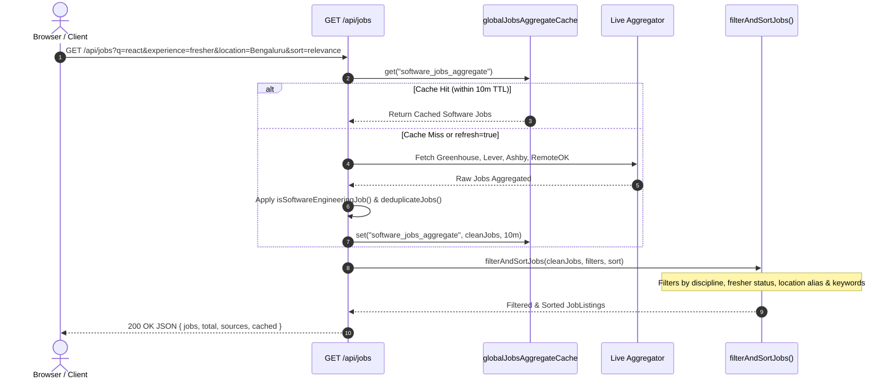

# API-01: Job Search Sequence Diagram (`GET /api/jobs`)

## 1. Sequence Diagram: Job Search & Filter Execution

---

## 2. Key Edge Cases Handled
1. **Empty Query Parameter (`q=""`)**: Returns the full curated tech job feed without text filtering.
2. **Force Refresh (`refresh=true`)**: Invalidates the 10-minute in-memory cache and triggers immediate re-harvesting from active ATS providers.
3. **Location Aliases**: Queries for `"Bengaluru"` match postings tagged with `"Bangalore"`, `"Whitefield"`, or `"BLR"`.
