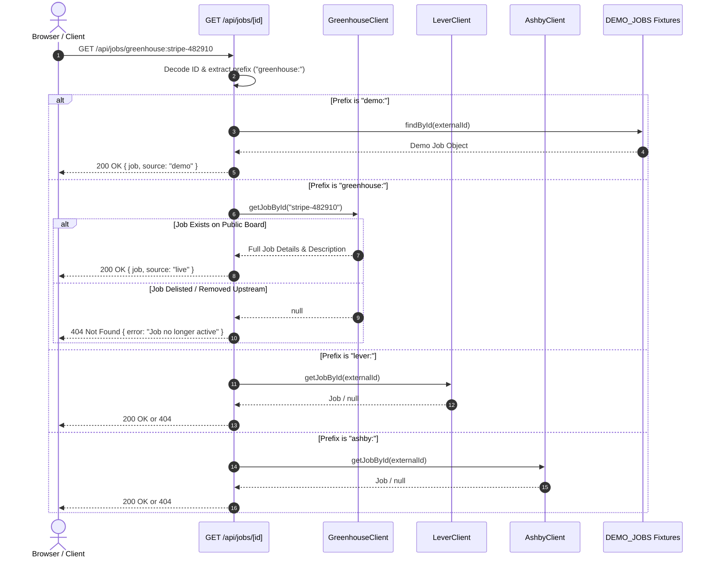

# API-02: Job Detail Lookup Sequence Diagram (`GET /api/jobs/[id]`)

## 1. Sequence Diagram: Job Detail Resolution

---

## 2. Dynamic Provider Routing
The route handler dynamically parses the composite ID prefix (`{provider}:{externalId}`) to invoke the correct client without executing exhaustive scans across all upstream systems.
