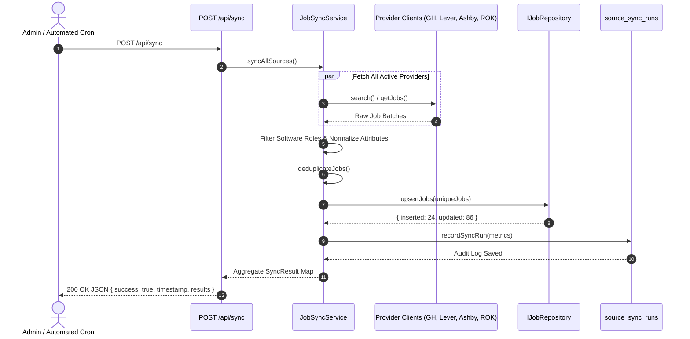

# API-03: Job Synchronization Sequence Diagram (`POST /api/sync`)

## 1. Sequence Diagram: Ingestion & Sync Execution

---

## 2. Telemetry Recorded in `source_sync_runs`
For each provider, the orchestrator logs:
- `source_id`: Source identifier (e.g. `'greenhouse'`).
- `status`: `'success'`, `'partial'`, or `'failed'`.
- `jobs_found`: Count of harvested items.
- `jobs_inserted`: Count of newly created listings.
- `jobs_updated`: Count of refreshed existing records.
- `duration_ms`: Execution time in milliseconds.
