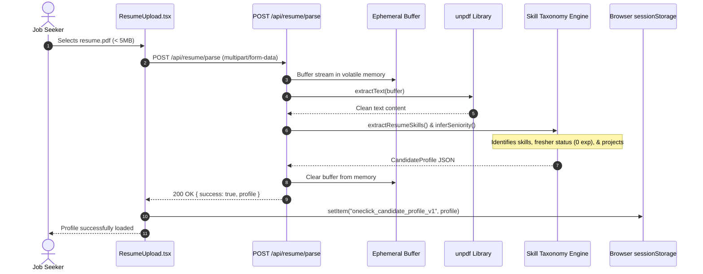

# API-04: Resume Upload & Parsing Sequence Diagram (`POST /api/resume/parse`)

## 1. Sequence Diagram: Privacy-First Resume Parsing

---

## 2. Zero-Retention Security Architecture
- The resume file binary exists strictly inside the scope of the HTTP request.
- No database records, S3 buckets, or temporary filesystem files are created.
- The browser stores the resulting structured profile strictly in `sessionStorage`, ensuring it is cleared when the browser tab is closed.
