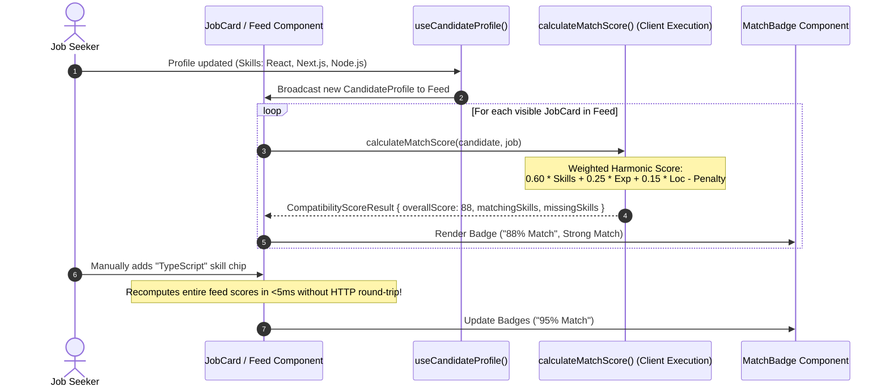

# API-05: Compatibility Scoring Loop Sequence Diagram

## 1. Sequence Diagram: Client-Side Dynamic Scoring Loop

---

## 2. High-Performance Client Execution
Because `src/server/matching/scoring.ts` is pure TypeScript without Node.js-specific imports, it executes directly inside the React 19 client runtime. This eliminates network latency when candidates tweak their skills or experience sliders.
