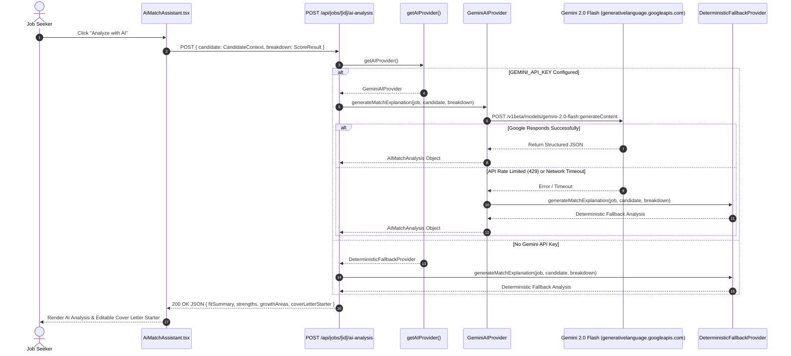

# API-06: AI Analysis Sequence Diagram (`POST /api/jobs/[id]/ai-analysis`)

## 1. Sequence Diagram: AI Analysis & Cover Letter Generation

---

## 2. Guaranteed Delivery
The AI endpoint implements zero-failure fallbacks: if Google Gemini experiences an upstream failure, candidates immediately receive high-quality deterministic insights without noticing an error.
