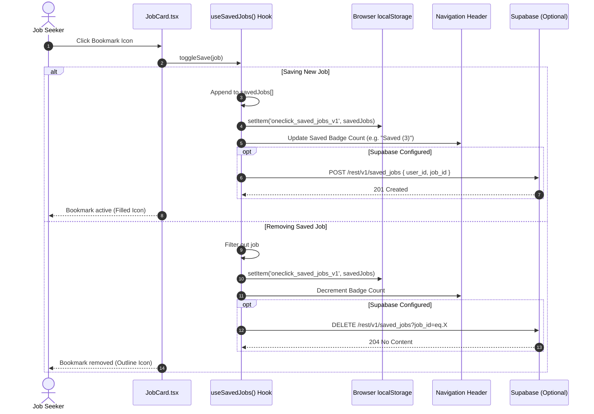

# API-07: Saved Jobs Persistence Sequence Diagram

## 1. Sequence Diagram: Job Bookmarking & State Persistence

---

## 2. Browser Storage Key
Saved jobs are serialized in `localStorage` under `oneclick_saved_jobs_v1`, surviving browser refreshes and tab closures.
