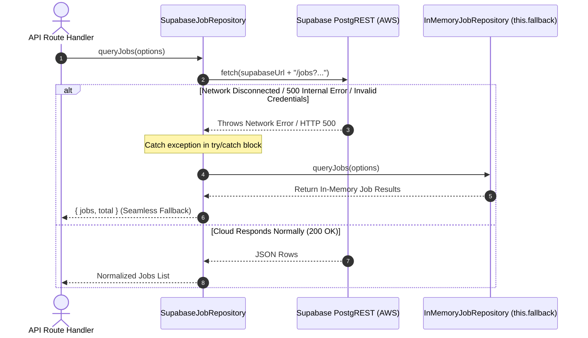

# API-08: Database Fallback Sequence Diagram

## 1. Sequence Diagram: Supabase Exception Interception & Fallback

---

## 2. Zero-Crash Reliability
Because `SupabaseJobRepository` encapsulates an instance of `InMemoryJobRepository`, third-party database downtime does not disrupt API availability.
