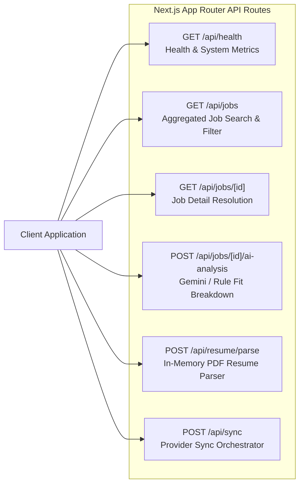

# API-00: Complete API Inventory & Route Catalog

## 1. Overview
This catalog details all HTTP API routes hosted under Next.js App Router in **OneClick Jobs** (`src/app/api/`).

---

## 2. API Route Summary

---

## 3. Route Specification Table

| Route Path | Method | Auth Required | Cache Strategy | Upstream Dependencies | Primary Purpose |
|---|---|---|---|---|---|
| `/api/health` | `GET` | No | `no-store` | Node.js Process, Repository | Health monitoring, memory stats, provider status |
| `/api/jobs` | `GET` | No | 10 min RAM Cache | Greenhouse, Lever, Ashby, RemoteOK | Search, filter, and retrieve software jobs |
| `/api/jobs/[id]` | `GET` | No | Upstream Cache | Specific ATS Client | Resolves complete job description & metadata |
| `/api/jobs/[id]/ai-analysis` | `POST` | No | `no-store` | Google Gemini 2.0 Flash / Local Rules | Generates fit summary, skill gaps & cover letter |
| `/api/resume/parse` | `POST` | No | `no-store` | `unpdf`, Skill Dictionary | In-memory text extraction, skill & fresher detection |
| `/api/sync` | `POST` | No / Admin | `no-store` | `JobSyncService`, All Providers | Ingests new postings from ATS boards into repo |
