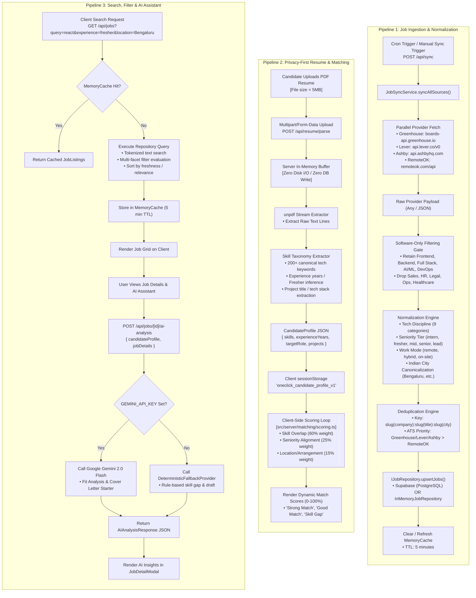

# HLD-05: Overall Data Flow Architecture

## 1. Purpose & Scope
This document details the end-to-end data lifecycle across the **OneClick Jobs** platform. It traces three fundamental operational workflows:
1. **The Ingestion & Aggregation Pipeline** (Harvesting, filtering, normalizing, and storing job listings).
2. **The Resume & Candidate Matching Pipeline** (Privacy-first text extraction, skill tagging, and client-side scoring).
3. **The Search & Query Resolution Flow** (Keyword tokenization, location expansion, facet filtering, and pagination).

---

## 2. Mermaid Diagram: End-to-End System Data Flow

---

## 3. Detailed Data Transformations

### 3.1 Job Ingestion Pipeline
1. **Raw Payload Ingestion**: Heterogeneous JSON structures from Greenhouse, Lever, Ashby, and RemoteOK arrive asynchronously.
2. **Software Discipline Gating**: Jobs without engineering keywords in titles or descriptions are immediately discarded.
3. **Discipline & Seniority Normalization**:
   - Title containing `"React"`, `"Frontend"`, `"CSS"` $\rightarrow$ `Frontend`.
   - Title containing `"Fresher"`, `"Graduate"`, `"Junior"`, `"Entry Level"`, or $0-1$ years exp $\rightarrow$ `fresher`.
   - Work arrangements: `"Remote"`, `"Work from Home"` $\rightarrow$ `remote`; `"Hybrid"` $\rightarrow$ `hybrid`; others $\rightarrow$ `on-site`.
   - Locations: `"Blr"`, `"Bangalore"`, `"Bengaluru"` $\rightarrow$ `Bengaluru`.
4. **Deduplication Matrix**: Jobs sharing identical company, canonical title, and canonical city are merged, preserving the authoritative ATS application URL.

### 3.2 Resume Extraction Pipeline
1. **Zero-Persistence Upload**: The binary PDF is sent as `multipart/form-data` to `/api/resume/parse`.
2. **Buffer Extraction**: Read into Node.js buffer via `unpdf`.
3. **Taxonomy Matching**: Matched against 200+ canonical developer competencies (e.g. `React`, `TypeScript`, `Node.js`, `Docker`, `PostgreSQL`, `Tailwind CSS`, `Python`).
4. **Seniority Inference**:
   - Detects graduation keywords (e.g., "Batch 2024", "Expected 2025", "B.Tech Fresher", "College Student") $\rightarrow$ Marks as `fresher` (0 years experience).
   - Detects employment date ranges (e.g., "Jan 2021 - Present") $\rightarrow$ Calculates total career months.
5. **Client Caching**: Stored in `sessionStorage` under `oneclick_candidate_profile_v1`. Raw PDF is wiped from memory.

### 3.3 Scoring & AI Workflow
1. **Client-Side Scoring Loop**: Calculates compatibility $S \in [0, 100]$ using weighted harmonic averages:
   $$S = W_{\text{skill}} \cdot \text{SkillScore} + W_{\text{exp}} \cdot \text{ExpScore} + W_{\text{loc}} \cdot \text{LocScore}$$
   If a candidate is a fresher applying for a `lead` or `senior` role, a seniority penalty reduces the score to prevent misleading match ratings.
2. **AI Career Assistant**: When the user requests an AI analysis, the client sends the job ID and candidate profile. The server generates a customized fit explanation, highlighted strengths, missing prerequisites, and an interview starter pitch.
