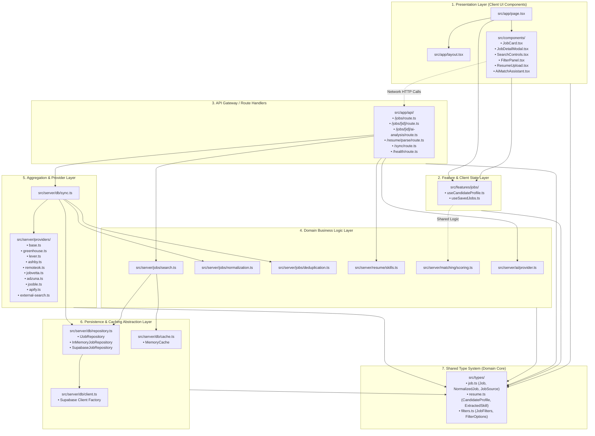

# HLD-06: Module Dependency Architecture

## 1. Purpose & Scope
This document outlines the source-code module dependencies across **OneClick Jobs**, ensuring clean architectural layering, strict separation of concerns, and unidirectional dependency enforcement.

---

## 2. Mermaid Diagram: Codebase Module Dependency Hierarchy

---

## 3. Dependency Boundary Rules

1. **Unidirectional Downward Dependencies**:
   - Higher layers may import from lower layers; lower layers **never** import from higher layers.
   - For example, `src/server/db/repository.ts` has zero knowledge of `src/app/api/` or `src/components/`.

2. **Server / Client Isolation**:
   - Files designated with `"use client"` in `src/components/` and `src/features/` do not import Node.js server libraries (`fs`, `crypto`, `@supabase/supabase-js` service role keys, or `unpdf`).
   - Server-only route handlers and engines under `src/server/` do not import React client hooks or browser globals (`window`, `localStorage`, `sessionStorage`).

3. **Domain Reusability**:
   - `src/server/matching/scoring.ts` is pure TypeScript without Node.js-specific or DOM-specific dependencies. This allows it to execute on both the server (for batch evaluations) and on the client (for instantaneous slider recalculation in React).

4. **Shared Type System**:
   - `src/types/` serves as the single source of truth for all data contracts (`Job`, `CandidateProfile`, `JobFilters`). All layers depend on these interface definitions without circular imports.
