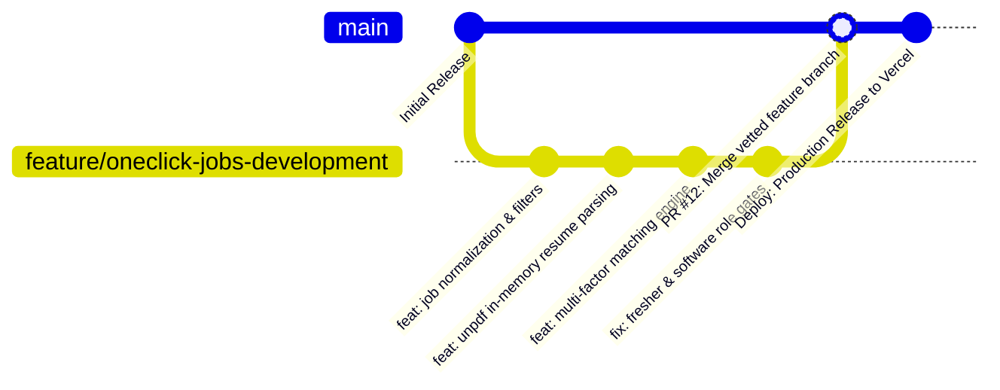
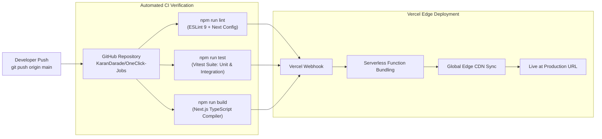
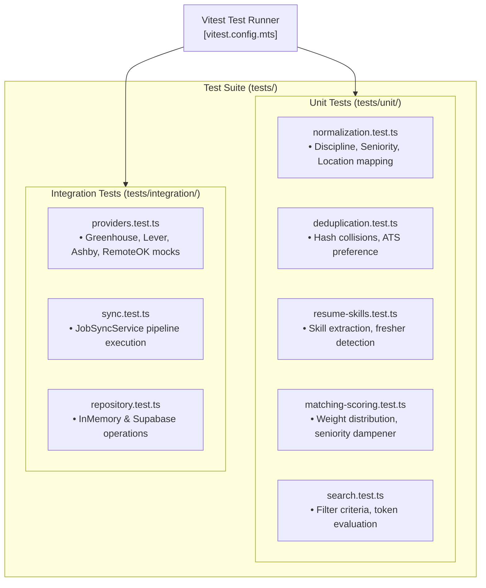
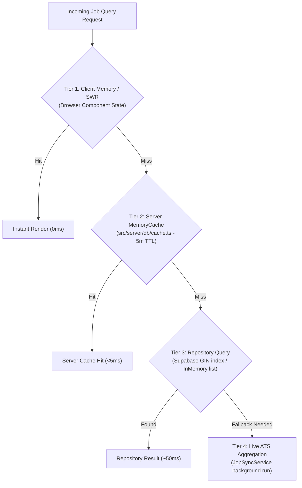
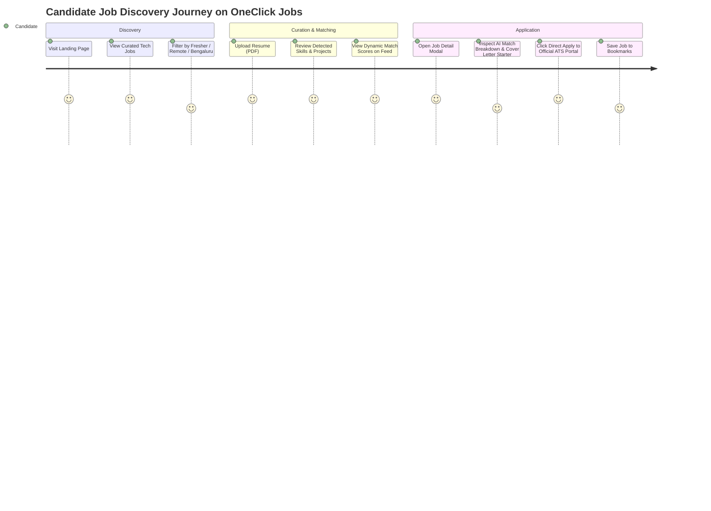

# Supporting Engineering Diagrams & Specifications

## 1. Purpose & Scope
This document complements the core HLD documents with engineering workflow diagrams covering developer workflows, automated test pipelines, multi-tiered caching strategies, security boundaries, and the end-user navigation journey.

---

## 2. Engineering Architecture Diagrams

### 2.1 Git Branching & Release Workflow


### 2.2 CI/CD Build & Deployment Lifecycle


### 2.3 Testing Architecture (Vitest)


### 2.4 Multi-Tier Cache Architecture


### 2.5 Security & Privacy Boundary
```mermaid
flowchart LR
    subgraph PublicBoundary["Public Untrusted Boundary"]
        CLIENT["User Browser"]
        RESUME_PDF["Candidate PDF Resume"]
    end

    subgraph SecureServerless["Secure Next.js Serverless Execution"]
        ROUTE["POST /api/resume/parse"]
        RAM_BUFFER["In-Memory Buffer<br/>(Ephemeral RAM)"]
        UNPDF_ENGINE["unpdf Extractor"]
        EXTRACTOR["Skill & Project Matcher"]
    end

    subgraph ZeroTrustStorage["Persistence Layers"]
        DB[(Supabase PostgreSQL)]
        DISK[("Server Hard Disk")]
    end

    CLIENT -->|Encrypted HTTPS Stream| ROUTE
    RESUME_PDF --> ROUTE
    ROUTE --> RAM_BUFFER
    RAM_BUFFER --> UNPDF_ENGINE
    UNPDF_ENGINE --> EXTRACTOR
    EXTRACTOR -->|Sanitized Profile JSON| CLIENT
    
    RAM_BUFFER -.->|WIPED IMMEDIATELY| DISK
    RAM_BUFFER -.x|BLOCKED: Zero Resume DB Storage| DB
```

### 2.6 End-to-End User Journey


---

## 3. Engineering Best Practices Implemented
1. **Privacy By Architecture**: Resumes are parsed completely in ephemeral serverless RAM. Zero storage buckets, zero local file writes, and zero database entries for candidate CVs.
2. **Zero-Configuration Fallback**: The platform functions seamlessly offline or without API keys, defaulting to static fixtures, `InMemoryJobRepository`, and `DeterministicFallbackProvider`.
3. **Deterministic Match Scoring**: Matching algorithms run client-side in sub-millisecond execution, enabling fluid filtering and instant feedback.
