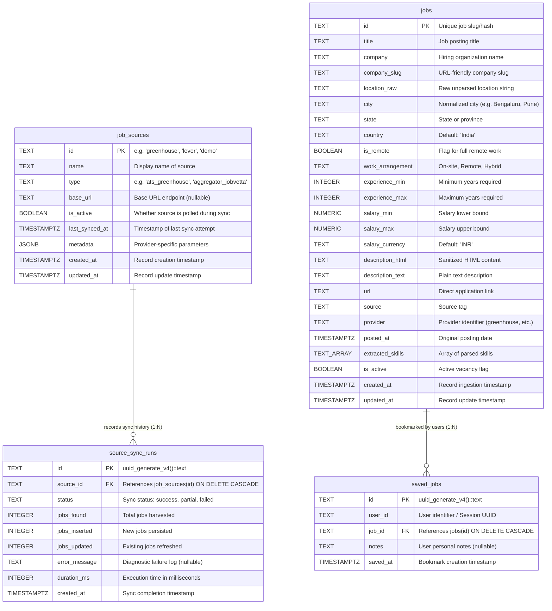

# DB-01: Entity Relationship Diagram (ERD)

## 1. Purpose & Scope
This document specifies the exact PostgreSQL Entity Relationship Diagram for **OneClick Jobs** based on the canonical SQL migration: [supabase/migrations/20261027_init.sql](file:///c:/Users/KARAN/Desktop/Web%20Development/Anti%20Gravity/Jobs%20Curator/oneclick-jobs/supabase/migrations/20261027_init.sql).

No theoretical or unmigrated entities are included.

---

## 2. Mermaid Diagram: Database Entity Relationship

---

## 3. Relational Cardinalities & Constraints

### 3.1 `job_sources` to `source_sync_runs`
- **Cardinality**: One-to-Many ($1 : N$).
- **Foreign Key**: `source_sync_runs.source_id` $\rightarrow$ `job_sources.id`.
- **Referential Action**: `ON DELETE CASCADE`. If a source is deleted from the catalog, its historical audit runs are pruned automatically.

### 3.2 `jobs` to `saved_jobs`
- **Cardinality**: One-to-Many ($1 : N$).
- **Foreign Key**: `saved_jobs.job_id` $\rightarrow$ `jobs.id`.
- **Referential Action**: `ON DELETE CASCADE`. If an expired job is purged from `jobs`, associated user bookmarks are removed to prevent orphan references.
- **Unique Constraint**: `CONSTRAINT unique_user_saved_job UNIQUE(user_id, job_id)`. Prevents duplicate bookmarks for the same job by the same user.

### 3.3 Architectural Note on `jobs.provider`
`jobs.provider` and `jobs.source` are stored as indexable `TEXT` columns rather than formal foreign keys to `job_sources.id`. This deliberate architectural choice allows ingestion pipelines to ingest valid jobs from ad-hoc or dynamic providers without failing foreign key constraints if the catalog record has not yet been seeded.

---

## 4. Verification Reference
- Migration Source: [supabase/migrations/20261027_init.sql](file:///c:/Users/KARAN/Desktop/Web%20Development/Anti%20Gravity/Jobs%20Curator/oneclick-jobs/supabase/migrations/20261027_init.sql#L1-L92)
