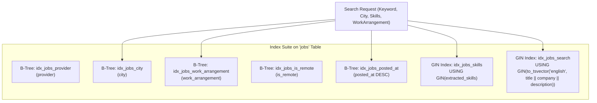

# DB-02: Relational Schema & Indexing Specification

## 1. Purpose & Scope
This document specifies the exact PostgreSQL schema, data types, constraints, default expressions, and index strategies defined in [supabase/migrations/20261027_init.sql](file:///c:/Users/KARAN/Desktop/Web%20Development/Anti%20Gravity/Jobs%20Curator/oneclick-jobs/supabase/migrations/20261027_init.sql).

---

## 2. Table Specifications

### 2.1 Table: `job_sources`
Catalog of configured job providers and sync scheduling state.

| Column Name | Data Type | Nullable | Default | Description / Constraints |
|---|---|---|---|---|
| `id` | `TEXT` | No | — | Primary Key (e.g. `'greenhouse'`, `'lever'`, `'demo'`). |
| `name` | `TEXT` | No | — | Human-readable provider label. |
| `type` | `TEXT` | No | — | Discriminator (`'ats_greenhouse'`, `'aggregator_jobvetta'`). |
| `base_url` | `TEXT` | Yes | `NULL` | Base API endpoint URL. |
| `is_active` | `BOOLEAN` | No | `true` | Polling toggle flag. |
| `last_synced_at`| `TIMESTAMPTZ`| Yes | `NULL` | Timestamp of last sync completion. |
| `metadata` | `JSONB` | Yes | `'{}'::jsonb`| Provider-specific credentials/options. |
| `created_at` | `TIMESTAMPTZ`| No | `NOW()` | Record creation timestamp. |
| `updated_at` | `TIMESTAMPTZ`| No | `NOW()` | Record modification timestamp. |

---

### 2.2 Table: `jobs`
Canonical repository of normalized software engineering opportunities.

| Column Name | Data Type | Nullable | Default | Description / Constraints |
|---|---|---|---|---|
| `id` | `TEXT` | No | — | Primary Key (canonical deterministic hash). |
| `title` | `TEXT` | No | — | Sanitized position title. |
| `company` | `TEXT` | No | — | Hiring company name. |
| `company_slug` | `TEXT` | Yes | `NULL` | URL-safe company identifier. |
| `location_raw` | `TEXT` | Yes | `NULL` | Raw unparsed location string from provider. |
| `city` | `TEXT` | Yes | `NULL` | Normalized city (e.g., `'Bengaluru'`, `'Pune'`). |
| `state` | `TEXT` | Yes | `NULL` | Normalized state or region. |
| `country` | `TEXT` | No | `'India'` | Country name. |
| `is_remote` | `BOOLEAN` | No | `false` | Remote eligibility flag. |
| `work_arrangement` | `TEXT` | No | `'On-site'` | Canonical arrangement: `'On-site'`, `'Remote'`, `'Hybrid'`. |
| `experience_min`| `INTEGER` | Yes | `NULL` | Minimum experience required (years). |
| `experience_max`| `INTEGER` | Yes | `NULL` | Maximum experience threshold (years). |
| `salary_min` | `NUMERIC` | Yes | `NULL` | Salary floor. |
| `salary_max` | `NUMERIC` | Yes | `NULL` | Salary ceiling. |
| `salary_currency`| `TEXT` | Yes | `'INR'` | Currency code (INR, USD, EUR). |
| `description_html`| `TEXT` | Yes | `NULL` | Sanitized rich HTML job posting. |
| `description_text`| `TEXT` | Yes | `NULL` | Plain text content for indexing. |
| `url` | `TEXT` | No | — | Direct ATS application URL. |
| `source` | `TEXT` | No | — | Source taxonomy tag. |
| `provider` | `TEXT` | No | — | Provider engine identifier. |
| `posted_at` | `TIMESTAMPTZ`| Yes | `NULL` | Original publication timestamp. |
| `extracted_skills`| `TEXT[]` | Yes | `'{}'` | Normalized technology skill keywords. |
| `is_active` | `BOOLEAN` | No | `true` | Active status (false if expired/delisted). |
| `created_at` | `TIMESTAMPTZ`| No | `NOW()` | Ingestion timestamp. |
| `updated_at` | `TIMESTAMPTZ`| No | `NOW()` | Last update timestamp. |

---

### 2.3 Table: `source_sync_runs`
Audit and telemetry logging for every synchronization attempt.

| Column Name | Data Type | Nullable | Default | Description / Constraints |
|---|---|---|---|---|
| `id` | `TEXT` | No | `uuid_generate_v4()::text` | Primary Key (UUIDv4). |
| `source_id` | `TEXT` | No | — | Foreign Key $\rightarrow$ `job_sources(id)` `ON DELETE CASCADE`. |
| `status` | `TEXT` | No | — | Status outcome: `'success'`, `'partial'`, `'failed'`. |
| `jobs_found` | `INTEGER` | No | `0` | Count of jobs detected during fetch. |
| `jobs_inserted`| `INTEGER` | No | `0` | Count of new jobs persisted. |
| `jobs_updated` | `INTEGER` | No | `0` | Count of existing jobs refreshed. |
| `error_message`| `TEXT` | Yes | `NULL` | Stack trace or failure description. |
| `duration_ms` | `INTEGER` | No | `0` | Total run duration in milliseconds. |
| `created_at` | `TIMESTAMPTZ`| No | `NOW()` | Run completion timestamp. |

---

### 2.4 Table: `saved_jobs`
User bookmarks for tracked job listings.

| Column Name | Data Type | Nullable | Default | Description / Constraints |
|---|---|---|---|---|
| `id` | `TEXT` | No | `uuid_generate_v4()::text` | Primary Key (UUIDv4). |
| `user_id` | `TEXT` | No | — | User or session identifier. |
| `job_id` | `TEXT` | No | — | Foreign Key $\rightarrow$ `jobs(id)` `ON DELETE CASCADE`. |
| `notes` | `TEXT` | Yes | `NULL` | Optional personal user notes. |
| `saved_at` | `TIMESTAMPTZ`| No | `NOW()` | Bookmark creation timestamp. |

**Composite Constraints:**
- `CONSTRAINT unique_user_saved_job UNIQUE(user_id, job_id)`

---

## 3. Database Indexes & Query Optimizations

### Index Functionality Rationale
1. **`idx_jobs_search` (GIN Full-Text Index)**: Computes a `tsvector` over title, company, and description. Executes sub-millisecond keyword lookups (`@@ to_tsquery()`) even across 100,000+ records.
2. **`idx_jobs_skills` (GIN Array Index)**: Accelerates array overlap checks (`extracted_skills && ARRAY['React', 'TypeScript']`).
3. **`idx_jobs_posted_at` (B-Tree Descending)**: Accelerates chronological ordering for default feeds (`ORDER BY posted_at DESC`).
4. **`idx_jobs_city` & `idx_jobs_work_arrangement`**: Enables instantaneous facet filtering for Indian tech hubs and remote/hybrid preferences.
