# DB-04: Data Lifecycle Architecture

## 1. Purpose & Scope
This document details the lifecycle of a job opportunity record in **OneClick Jobs**, from external discovery on third-party ATS platforms to normalization, deduplication, indexing, client consumption, and eventual delisting.

---

## 2. Mermaid Diagram: Job Record State Lifecycle

```mermaid
stateDiagram-v2
    [*] --> Harvested: Ingested via Provider Client (Greenhouse, Lever, Ashby, RemoteOK)
    
    state Harvested {
        [*] --> RawPayload
        RawPayload --> SoftwareGateEvaluation
    }

    SoftwareGateEvaluation --> RejectedNonSoftware: Title/Description lacks tech keywords
    RejectedNonSoftware --> [*]: Dropped from memory
    
    SoftwareGateEvaluation --> ValidatedSoftware: Passes software engineering filter
    
    state ValidatedSoftware {
        [*] --> NormalizeDiscipline: Map to 9 Tech Disciplines
        NormalizeDiscipline --> NormalizeSeniority: Map to Intern, Fresher, Mid, Senior, Lead
        NormalizeSeniority --> NormalizeLocation: Map to canonical Indian cities (Bengaluru, etc.)
        NormalizeLocation --> NormalizeArrangement: Map to Remote, Hybrid, On-site
    }

    ValidatedSoftware --> Fingerprinting: Compute canonical hash key
    
    state Fingerprinting {
        [*] --> GenerateKey: slugify(company):slugify(title):slugify(city)
        GenerateKey --> CollisionCheck: Compare with existing memory/DB jobs
    }

    CollisionCheck --> DeduplicatedMerge: Duplicate detected -> Retain authoritative ATS
    CollisionCheck --> UniqueRecord: New unique job record

    DeduplicatedMerge --> UpsertRepository: Upsert into PostgreSQL / InMemory repository
    UniqueRecord --> UpsertRepository

    state UpsertRepository {
        [*] --> WriteJobRow: Insert or update row in 'jobs' table
        WriteJobRow --> RefreshIndexes: Rebuild GIN search & skill vectors
        RefreshIndexes --> InvalidateCache: Reset MemoryCache TTL
    }

    UpsertRepository --> ActiveInFeed: Available for Search & Ranking (/api/jobs)

    state ActiveInFeed {
        [*] --> SearchEvaluation: Matched by keywords / filters
        SearchEvaluation --> ClientScored: Dynamic match score applied on client
        ClientScored --> DisplayedInUI: Rendered in JobFeed & Detail Modal
        DisplayedInUI --> UserBookmarked: Saved to localStorage / saved_jobs
    }

    ActiveInFeed --> Delisted: Absent in subsequent sync runs / Provider returns 404
    Delisted --> [*]: Marked is_active = false or pruned
```

---

## 3. Detailed Lifecycle Stages

### Stage 1: Harvesting & Ingestion
- `JobSyncService` iterates through active providers.
- Provider clients make rate-limited HTTPS requests to endpoints (e.g., `boards-api.greenhouse.io/v1/boards/{company}/jobs?content=true`).
- Raw payload is captured in Node.js heap memory.

### Stage 2: Software Discipline Gating
- Role titles and descriptions are checked against strict software engineering patterns (Frontend, Backend, Full Stack, DevOps, Data & AI, QA, Mobile, Product).
- Non-software roles (e.g., *Account Executive*, *Clinical Nurse*, *Legal Counsel*, *Office Manager*) are immediately pruned to keep feeds clean and relevant.

### Stage 3: Multi-Attribute Normalization
- **Discipline**: Classified into one of 9 canonical tech categories.
- **Seniority**: Evaluated against years of experience and keywords. Freshers ($0-1$ years) are tagged specifically.
- **Location Canonicalization**: Metro aliases (e.g., `"Cyber City"`, `"Gurugram"`, `"Noida"` $\rightarrow$ `"Delhi NCR"`; `"Whitefield"`, `"Bangalore"` $\rightarrow$ `"Bengaluru"`).
- **Work Arrangement**: Classified as `'Remote'`, `'Hybrid'`, or `'On-site'`.

### Stage 4: Deduplication & Source Authority
- Computes deterministic slug: `${slug(company)}:${slug(title)}:${slug(city)}`.
- If a listing appears on both RemoteOK and Greenhouse, the direct Greenhouse link is given priority.

### Stage 5: Persistence & Cache Invalidation
- The record is written to Supabase `jobs` (or `InMemoryJobRepository`) with `is_active = true`.
- GIN indexes update automatically.
- Server-side `MemoryCache` keys are invalidated.

### Stage 6: Client Consumption & Matching
- Client queries `/api/jobs`.
- The matching engine calculates a personalized compatibility score ($0-100\%$) based on the candidate's active profile in `sessionStorage`.
- The candidate can view AI analysis or bookmark the job to `localStorage`.

### Stage 7: Delisting & Purge
- When a job is no longer returned by the upstream ATS board, subsequent sync runs set `is_active = false`.
- If an admin deletes a job, foreign keys in `saved_jobs` cascade delete automatically.
