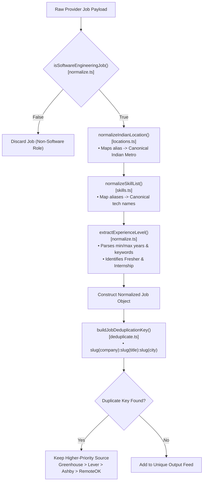

# LLD-03: Server Module Architecture & Domain Logic

## 1. Purpose & Scope
This document details the internal algorithms, data structures, and functional pipelines powering the core domain modules of **OneClick Jobs**:
- Job Normalization & Software Gating (`src/server/jobs/normalize.ts`)
- Location Canonicalization (`src/server/jobs/locations.ts`)
- Deduplication Matrix (`src/server/jobs/deduplicate.ts`)
- Skill & Experience Extraction (`src/server/resume/skills.ts`)
- Multi-Factor Compatibility Scoring (`src/server/matching/scoring.ts`)

---

## 2. Mermaid Diagram: Module Processing Pipeline



---

## 3. Module Specifications & Algorithms

### 3.1 Software Engineering Gatekeeper (`src/server/jobs/normalize.ts`)
The `isSoftwareEngineeringJob(title, description, skills)` function enforces strict feed purity.
- **Negative Exclusions**: Rejects keywords like `accountant`, `payroll`, `sales`, `hr`, `legal counsel`, `medical`, `nurse`, `customer support`, `tele-caller`.
- **Positive Affirmations**: Requires affirmative matches against software disciplines:
  - Frontend (`React`, `Vue`, `Next.js`, `Angular`, `Tailwind`)
  - Backend (`Node.js`, `Python`, `Java`, `Golang`, `PostgreSQL`, `FastAPI`)
  - Full Stack (`MERN`, `MEAN`, `SDE`, `SWE`)
  - DevOps & Cloud (`Kubernetes`, `Docker`, `Terraform`, `AWS`, `SRE`)
  - Data & AI (`Machine Learning`, `Data Engineer`, `Deep Learning`, `PyTorch`)
  - Mobile (`Android`, `iOS`, `Flutter`, `React Native`, `Kotlin`, `Swift`)
  - QA & Testing (`SDET`, `Automation Engineer`, `Playwright`, `Selenium`)

### 3.2 Indian Location Canonicalizer (`src/server/jobs/locations.ts`)
Resolves informal, vernacular, and corporate campus locations into standard Indian tech metropolises:
```typescript
const METRO_MAP: Record<string, string> = {
  "bangalore": "Bengaluru",
  "blr": "Bengaluru",
  "whitefield": "Bengaluru",
  "gurgaon": "Delhi NCR",
  "gurugram": "Delhi NCR",
  "noida": "Delhi NCR",
  "cyber city": "Delhi NCR",
  "navi mumbai": "Mumbai",
  "bombay": "Mumbai",
  "hitec city": "Hyderabad",
  "hyderabad": "Hyderabad",
  "hinjewadi": "Pune",
  "pune": "Pune",
  "chennai": "Chennai"
};
```

### 3.3 Deduplication Matrix (`src/server/jobs/deduplicate.ts`)
To prevent feed flooding when multiple aggregators list the same position:
1. **Fingerprint**: Computes `${slug(company)}:${slug(title)}:${slug(city)}`.
2. **Authority Hierarchy**:
   $$\text{Greenhouse} > \text{Lever} > \text{Ashby} > \text{Jobvetta} > \text{Adzuna} > \text{Jooble} > \text{RemoteOK}$$
3. **Merge**: If two identical listings collide, the higher-ranking ATS URL is preserved as the application target.

### 3.4 In-Memory Skill & Fresher Inference (`src/server/resume/skills.ts`)
- **PDF Extraction**: Employs `unpdf` to extract stream buffers in RAM without spawning shell processes or saving to disk.
- **200+ Keyword Taxonomy**: Checks token boundaries (`\b`) to eliminate false positives (e.g., `"Java"` does not falsely match `"JavaScript"`).
- **Fresher Recognition**:
  - Checks for `"Fresher"`, `"Graduate"`, `"Batch 2024"`, `"2025 Passout"`, `"College Student"`.
  - Distinguishes internships and academic projects from full-time tenure.
  - Correctly tags `isFresher: true` with `experienceYears: 0`.

### 3.5 Mathematical Compatibility Scoring Model (`src/server/matching/scoring.ts`)
Computes an objective compatibility score $S \in [0, 100]$:
$$S = \max(0, \min(100, W_{\text{skills}} \cdot S_{\text{skills}} + W_{\text{exp}} \cdot S_{\text{exp}} + W_{\text{loc}} \cdot S_{\text{loc}} - P_{\text{seniority}}))$$

Where:
- $W_{\text{skills}} = 0.60$ (Direct skill overlap percentage against required and preferred skills).
- $W_{\text{exp}} = 0.25$ (Candidate years of experience evaluated against job minimum threshold).
- $W_{\text{loc}} = 0.15$ (Alignment between candidate preferred city/remote and job's arrangement).
- $P_{\text{seniority}}$: Seniority Mismatch Penalty. If candidate is a Fresher/Junior applying for a `Senior` or `Lead` position, a 30-point deduction is applied to prevent misleading 90%+ match false positives.
