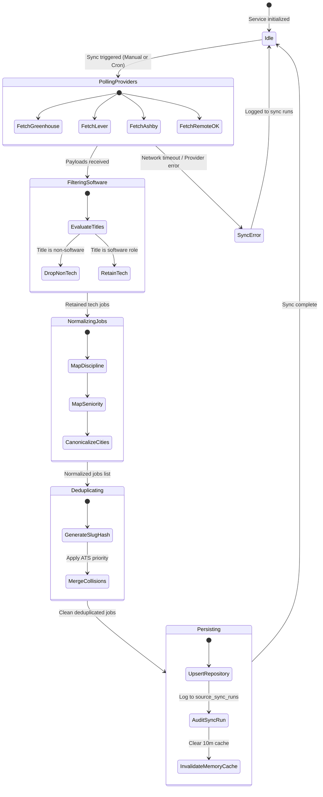
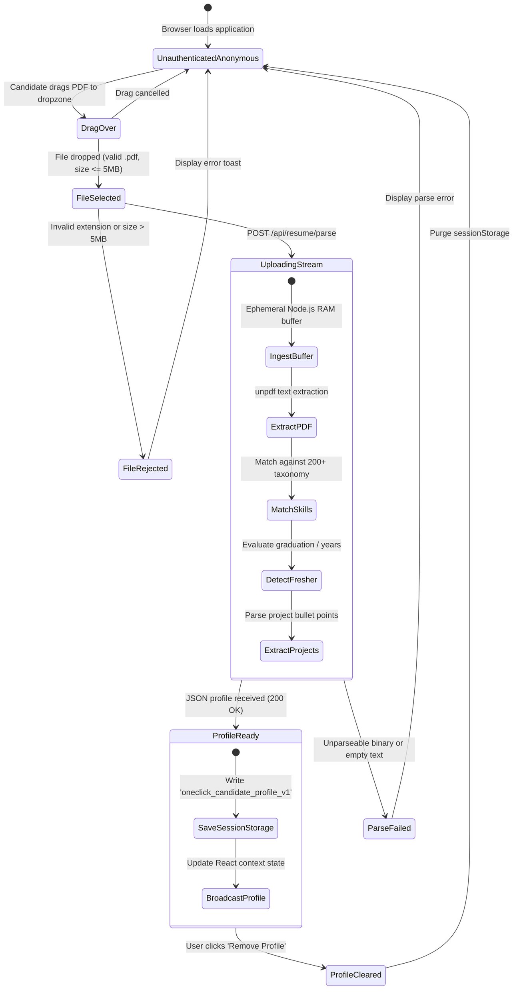
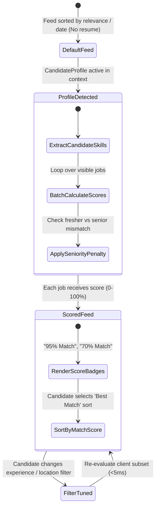
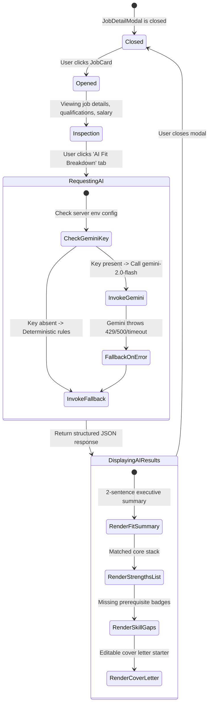

# LLD-04: System State Machine Diagrams

## 1. Purpose & Scope
This document models the dynamic behavior of **OneClick Jobs** using UML State Machine diagrams. It covers the four primary state lifecycles: Job Ingestion, Resume Upload, Candidate Auto-Match, and AI Career Analysis.

---

## 2. State Machine Diagrams

### 2.1 Job Ingestion State Machine

---

### 2.2 Resume Upload & Profile Extraction Lifecycle

---

### 2.3 Candidate Dynamic Auto-Match Lifecycle

---

### 2.4 AI Career Assistant State Machine

