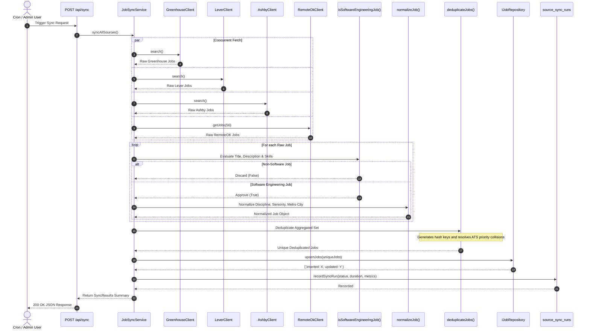

# WF-01: Job Aggregation & Ingestion Pipeline

## 1. Purpose & Scope
This workflow document outlines the automated and on-demand job ingestion pipeline in **OneClick Jobs**. It details how raw job listings are harvested in parallel from Greenhouse, Lever, Ashby, and RemoteOK, filtered through the software gate, normalized, deduplicated, and committed to storage.

---

## 2. Mermaid Diagram: Aggregation Pipeline Flow

---

## 3. Resilience & Isolation Mechanisms
1. **Parallel Execution with Error Isolation**: Ingestion queries are triggered concurrently using `Promise.allSettled()`. If a single provider fails (e.g. Lever returns 502 Bad Gateway), other providers (Greenhouse, Ashby, RemoteOK) complete normally without aborting the entire sync run.
2. **Rate Limiting & Concurrency Throttling**: Requests to external ATS endpoints are sent with a custom `User-Agent` and respect HTTP 429 rate limit responses with exponential backoff.
3. **Database Write Batching**: Supabase upserts utilize `Prefer: resolution=merge-duplicates` batch writes to minimize HTTP round-trips.
