# WF-02: Job Search & Filtering Workflow

## 1. Purpose & Scope
This workflow specifies how search queries and multi-attribute filters submitted by the client are evaluated, cached, ranked, and returned by the search engine.

---

## 2. Mermaid Diagram: Search & Ranking Workflow

```mermaid
flowchart TD
    CLIENT["Client initiates search / toggles filter<br/>GET /api/jobs?q=react&experience=fresher&location=Bengaluru"] --> PARSE_PARAMS["Parse Query Parameters & Filters<br/>• Keyword (q)<br/>• Location<br/>• Experience Levels<br/>• Tech Disciplines<br/>• Work Arrangements<br/>• Sort Order"]

    PARSE_PARAMS --> CHECK_CACHE{"Cache Hit in globalJobsAggregateCache?<br/>(10m TTL)"}
    
    CHECK_CACHE -- Yes & !forceRefresh --> GET_CACHED["Retrieve Cached Software Job Pool"]
    CHECK_CACHE -- No or forceRefresh --> RUN_AGGREGATION["Execute Live Aggregation & Deduplication<br/>(Greenhouse, Lever, Ashby, RemoteOK, Demo)"]
    RUN_AGGREGATION --> POPULATE_CACHE["Store Clean Software Pool in Cache"]
    POPULATE_CACHE --> GET_CACHED

    GET_CACHED --> FILTER_DISCIPLINE{"Discipline Filter Active?"}
    FILTER_DISCIPLINE -- Yes --> MATCH_DISC["Filter by Tech Discipline<br/>(Frontend, Backend, AI/ML, etc.)"]
    FILTER_DISCIPLINE -- No --> FILTER_EXP
    MATCH_DISC --> FILTER_EXP{"Experience Filter Active?"}

    FILTER_EXP -- Yes --> MATCH_EXP["Filter by Seniority Tier<br/>(Internship, Fresher, Mid, Senior, Lead)"]
    FILTER_EXP -- No --> FILTER_WORK
    MATCH_EXP --> FILTER_WORK{"Work Arrangement Active?"}

    FILTER_WORK -- Yes --> MATCH_WORK["Filter by Arrangement<br/>(Remote, Hybrid, On-site)"]
    FILTER_WORK -- No --> FILTER_LOC
    MATCH_WORK --> FILTER_LOC{"Location Filter Active?"}

    FILTER_LOC -- Yes & != 'All India' --> MATCH_LOC["Filter by Canonical Indian Metro<br/>(Bengaluru, Hyderabad, Pune, etc.)"]
    FILTER_LOC -- No or 'All India' --> FILTER_KW
    MATCH_LOC --> FILTER_KW{"Keyword (q) Provided?"}

    FILTER_KW -- Yes --> MATCH_KW["Score & Filter Tokens<br/>Against Title, Company, Description & Skills"]
    FILTER_KW -- No --> SORT_STEP

    MATCH_KW --> SORT_STEP["Apply Sorting<br/>• 'relevance': Token Match & Score<br/>• 'date': postedAt DESC<br/>• 'salary': salaryMax DESC"]

    SORT_STEP --> PAGINATE["Apply Limit & Offset Slice"]
    PAGINATE --> RETURN_JSON["Return JSON { jobs, total, sources, cached: true }"]
```

---

## 3. Filter Processing Rules
1. **Case-Insensitive Token Matching**: Search queries (e.g. `"full stack react"`) are split into individual tokens and matched against title, company, skills, and description text.
2. **Fresher Experience Matching**: If the `fresher` filter is active, jobs are included if:
   - `experienceLevel === "fresher"`
   - `experienceRange.minYears === 0`
   - Title matches `"Fresher"`, `"Graduate"`, `"Junior"`, `"Entry Level"`, or `"Trainee"`.
3. **Discipline Matching**: If `Data & AI` is chosen, the engine matches jobs classified as `data_ai` or containing machine learning, deep learning, PyTorch, LLM, or computer vision in skills/description.
