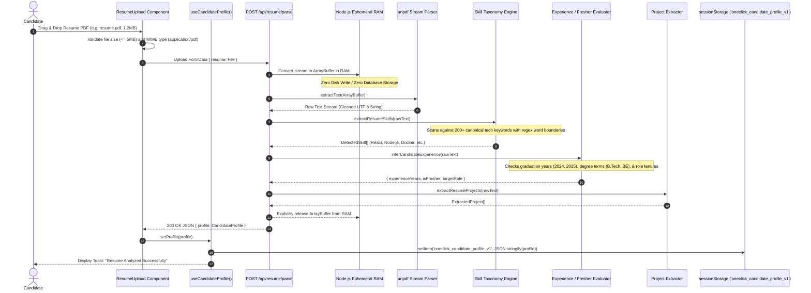

# WF-03: Privacy-First Resume Processing Pipeline

## 1. Purpose & Scope
This workflow specifies the privacy-first resume ingestion and parsing architecture in **OneClick Jobs**. It details how PDF resumes are parsed in ephemeral memory via `unpdf`, matched against the 200+ skill taxonomy, and evaluated for candidate seniority without storing files or PII on disk or cloud databases.

---

## 2. Mermaid Diagram: Resume Ingestion & Parsing Workflow

---

## 3. Privacy & Parsing Rules

### 3.1 Zero Data Retention Policy
- Resumes are parsed completely in Node.js volatile memory.
- No files are written to local disk (`/tmp`), cloud object storage (AWS S3, Supabase Storage), or database tables.
- Once the JSON profile response is serialized, the buffer is unreferenced and reclaimed by Node.js garbage collection.

### 3.2 Fresher Detection Heuristics
A candidate is flagged as a `fresher` (`isFresher: true`, `experienceYears: 0`) if any of the following criteria match:
1. Current or recent graduation years (e.g. `2024`, `2025`, `2026`) paired with degree keywords (`B.Tech`, `B.E.`, `BCA`, `MCA`, `B.Sc Computer Science`).
2. Presence of terms like `"Fresher"`, `"Final Year Student"`, `"Recent Graduate"`, `"Entry Level"`.
3. Absence of full-time professional experience exceeding 11 continuous months.

### 3.3 Skill Categorization
Extracted skills are categorized across:
- **Frontend**: React, Next.js, Vue, Angular, TypeScript, Tailwind CSS, Redux, HTML5/CSS3.
- **Backend**: Node.js, Express, NestJS, Python, Django, FastAPI, Java, Spring Boot, Golang, PostgreSQL, Redis.
- **DevOps & Cloud**: Docker, Kubernetes, AWS, GCP, Azure, GitHub Actions, Terraform, Linux.
- **Data & AI**: PyTorch, TensorFlow, Pandas, NumPy, Scikit-learn, LangChain, OpenCV.
