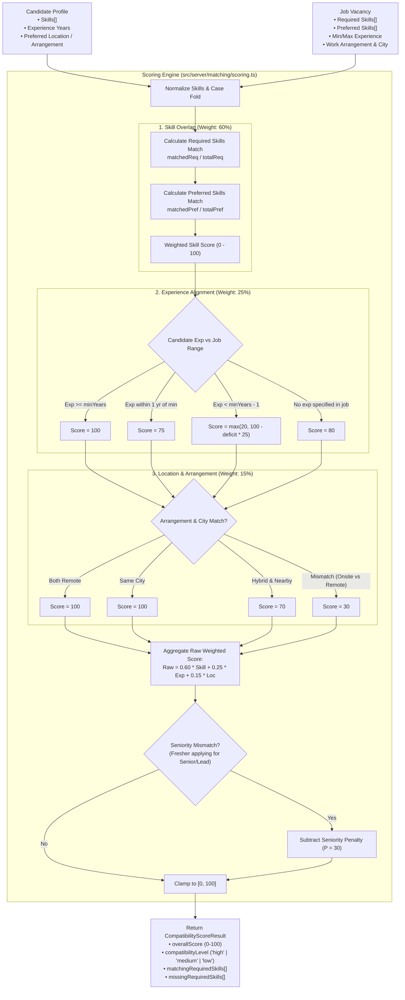

# WF-04: Candidate-Job Compatibility Scoring Workflow

## 1. Purpose & Scope
This workflow specifies the mathematical scoring model and evaluation pipeline implemented in `src/server/matching/scoring.ts`. The algorithm computes an objective, multi-factor compatibility score ($0-100\%$) between a candidate's profile and a job vacancy.

---

## 2. Mermaid Diagram: Scoring Pipeline

---

## 3. Mathematical Formula & Weight Distribution

The overall compatibility score $S$ is defined as:
$$S = \max\left(0, \min\left(100, W_s \cdot S_{\text{skills}} + W_e \cdot S_{\text{exp}} + W_l \cdot S_{\text{loc}} - P_{\text{seniority}}\right)\right)$$

### 3.1 Weight Breakdown
- **$W_s = 0.60$ (Skills Overlap)**:
  $$S_{\text{skills}} = \left(\frac{|\text{CandidateSkills} \cap \text{JobRequiredSkills}|}{\max(1, |\text{JobRequiredSkills}|)} \times 0.80 + \frac{|\text{CandidateSkills} \cap \text{JobPreferredSkills}|}{\max(1, |\text{JobPreferredSkills}|)} \times 0.20\right) \times 100$$
- **$W_e = 0.25$ (Experience Alignment)**:
  - If $\text{CandidateExp} \ge \text{MinYears}$: $S_{\text{exp}} = 100$.
  - If candidate is a Fresher and job is tagged `fresher` or `internship`: $S_{\text{exp}} = 100$.
  - If $\text{CandidateExp} < \text{MinYears}$: Penalized proportionally down to $20$.
- **$W_l = 0.15$ (Location & Work Mode)**:
  - Remote-to-Remote match: $100$.
  - Canonical city match (e.g. candidate in Bengaluru, job in Bengaluru): $100$.
- **$P_{\text{seniority}} = 30$ (Seniority Dampener)**:
  - Triggered when candidate experience is 0 years (fresher) and target job has `experienceLevel: "senior"` or `"lead"`. Prevents candidates from receiving misleading high scores on senior architect openings based solely on general programming keyword overlap.

### 3.2 Compatibility Level Thresholds
- **High / Strong Match**: $S \ge 75\%$
- **Medium / Good Match**: $50\% \le S < 75\%$
- **Low / Growth Opportunity**: $S < 50\%$
