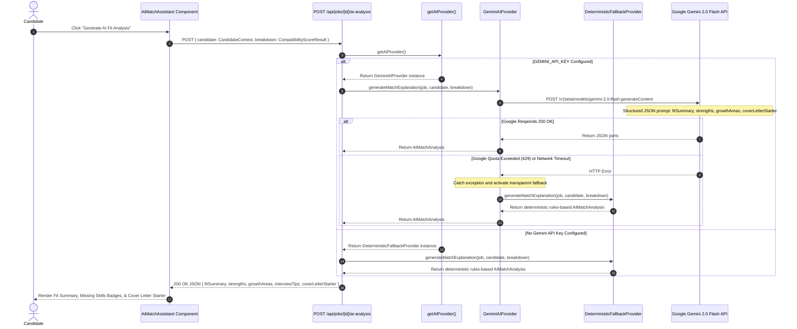

# WF-05: AI Career Assistant & Analysis Workflow

## 1. Purpose & Scope
This workflow specifies the AI Career Assistant execution model in **OneClick Jobs**. It traces the path from user invocation in `AiMatchAssistant.tsx` through Next.js server route handlers to Google Gemini 2.0 Flash, including prompt generation and graceful fallback to the local deterministic rules engine.

---

## 2. Mermaid Diagram: AI Career Assistant Sequence



---

## 3. Prompt Engineering & Deterministic Fallback Rules

### 3.1 Gemini 2.0 Flash System Prompt
The LLM is prompted strictly to return a JSON object:
```json
{
  "fitSummary": "A concise 2-sentence executive summary of the candidate's alignment",
  "strengths": ["string", "string"],
  "growthAreas": ["string", "string"],
  "interviewTips": ["string", "string"],
  "coverLetterStarter": "A personalized 3-sentence opening paragraph for a cover letter addressed to company"
}
```

### 3.2 Deterministic Fallback Rules
If no network or API key is available, `DeterministicFallbackProvider` guarantees zero disruption:
- **Score $\ge 80\%$**: Generates praise for core required stack alignment and highlights top matching skills.
- **Score $50-79\%$**: Flags key matching competencies while highlighting up to 3 missing skill prerequisites.
- **Score $< 50\%$**: Flags the role as a growth opportunity and recommends targeted portfolio projects.
- **Cover Letter Starter**: Assembles a customized, professionally phrased opening paragraph using company name, role title, and top 2 matched candidate skills.
