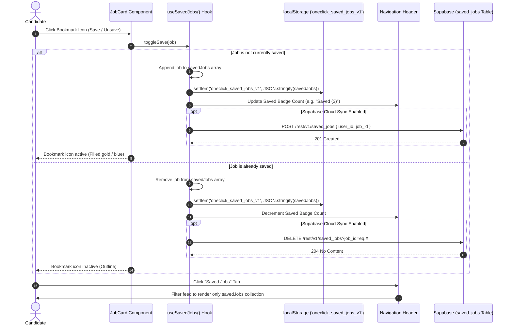

# WF-06: Saved Jobs & Bookmarks Workflow

## 1. Purpose & Scope
This workflow specifies how candidates bookmark, organize, and access saved job opportunities. It details the client-side state management using `useSavedJobs()`, browser persistence via `localStorage`, and the optional cloud synchronization path with Supabase `saved_jobs`.

---

## 2. Mermaid Diagram: Saved Jobs Lifecycle

---

## 3. Data Integrity & Sync Behaviors
1. **Offline Resilience**: Saved jobs work 100% reliably without user login or database connectivity by leveraging client `localStorage`.
2. **Cascade Deletion**: In Supabase, `saved_jobs.job_id` has an `ON DELETE CASCADE` constraint. If a job is purged from the `jobs` catalog, the corresponding bookmark is automatically removed.
3. **Payload Snapshot**: The browser stores both the `jobId` and essential preview fields (title, company, location, URL) so that bookmarked jobs can still be inspected even if offline.
