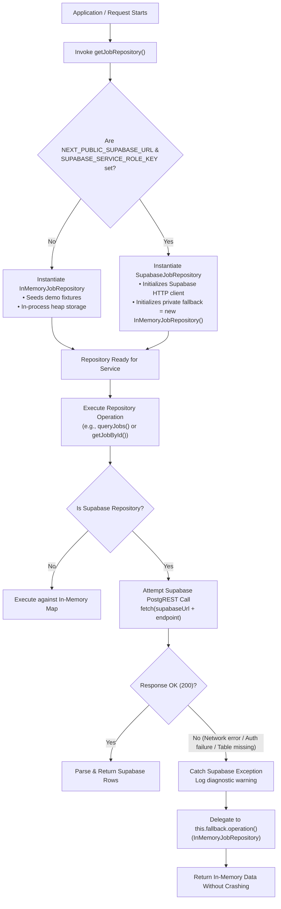

# WF-07: Database Resolution & Graceful Fallback Workflow

## 1. Purpose & Scope
This workflow specifies how **OneClick Jobs** resolves database persistence at boot time and during runtime execution. It demonstrates how `getJobRepository()` and `SupabaseJobRepository` implement a zero-crash architecture using the `InMemoryJobRepository` fallback.

---

## 2. Mermaid Diagram: Database Fallback Decision Tree

---

## 3. Reliability & Zero-Downtime Principles

### 3.1 Bootstrap Resilience
Developers or evaluators can run `npm run dev` immediately after cloning the repository without configuring Supabase, Docker, or environment variables. The system boots directly into `InMemoryJobRepository`.

### 3.2 Runtime Fault Tolerance
If Supabase experiences an infrastructure outage, DNS resolution timeout, or invalid API credentials mid-flight:
1. `SupabaseJobRepository` wraps all PostgREST operations in `try/catch` blocks.
2. Caught exceptions do not propagate as unhandled 500 errors to the client.
3. The query is immediately redirected to `this.fallback`, ensuring continuous, uninterrupted service to job seekers.
