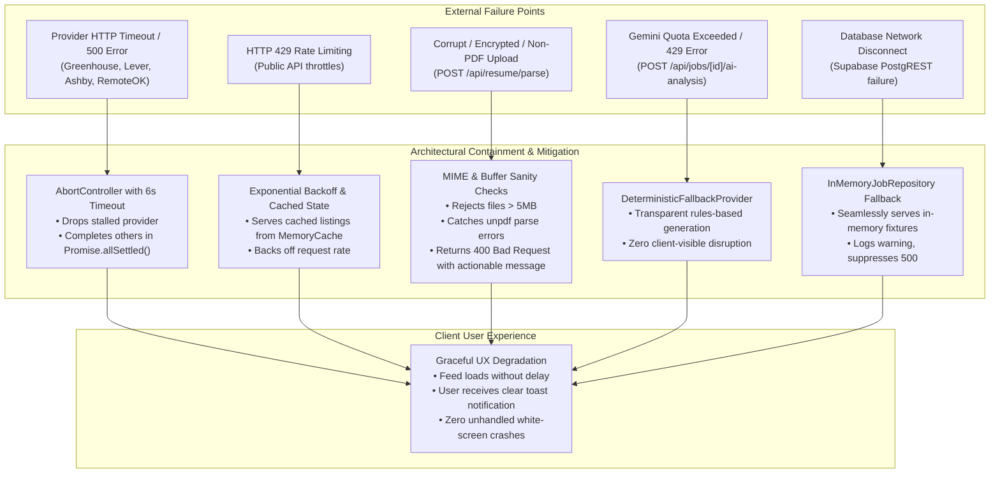

# WF-08: Error Handling & Fault Containment Workflow

## 1. Purpose & Scope
This workflow specifies the fault tolerance and error handling boundaries across **OneClick Jobs**. It covers external provider timeouts, rate-limit backoffs, corrupt resume uploads, missing job IDs, and AI generation exceptions.

---

## 2. Mermaid Diagram: Error Containment Matrix

---

## 3. Failure Domain Mitigation Policies

| Failure Scenario | Triggering Condition | Containment Strategy | Client User Experience |
|---|---|---|---|
| **External ATS Stalled** | Provider takes > 6000ms to respond | `AbortController` triggers `abort()`; `Promise.allSettled` discards slow source | Other provider feeds render immediately; missing provider is logged |
| **PDF Extraction Error** | Encrypted or damaged PDF uploaded | `try/catch` in `src/server/resume/skills.ts` catches unpdf parse exception | Form highlights error: "Unable to parse resume. Please ensure it is an unencrypted PDF." |
| **Gemini API Down / Throttled** | Gemini returns 429 Too Many Requests or 503 Service Unavailable | `GeminiAIProvider` catches exception and immediately delegates to `DeterministicFallbackProvider` | Fit summary and cover letter starter render without interruption |
| **Supabase Outage** | PostgREST returns 500 or times out | `SupabaseJobRepository` catches error and queries in-memory fallback | Feed continues displaying jobs without throwing 500 Internal Server Error |
| **Delisted Job Request** | User accesses link for job removed from ATS board | `GET /api/jobs/[id]` checks live provider, returns 404 | Modal displays: "This position is no longer active on the employer board." |
